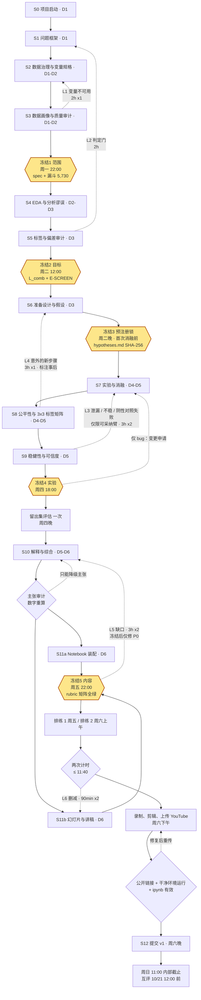

# CA6003 NHANES 项目开发流程设计

> 课程：CA6003 Best Practices in Data Governance, Preparation and Analytics
> 选题：A · NHANES 2021–23 成人糖尿病识别（Aug 2021 – Aug 2023 周期，文件后缀 `_L`）
> 版本：v1.0 · 2026-10-11 · 状态：**已通过交叉审计与汇总验收，可执行**
> 截止：主提交 2026-10-18（日）12:00；同伴评价 2026-10-21（三）12:00

---

## 0 文档说明

**用途**：记录本项目从启动到提交的全流程，包括阶段划分、反馈回路、冻结点、分工，以及每个阶段的具体方案。全组以本文档为执行依据。

**生成方式**：

| 轮次 | 做法 | 产出 |
|---|---|---|
| 框架 | Opus 设定阶段骨架、回路、统一格式与 10 条高层指导 | `framework.md` |
| 第 1 轮 | 4 个 Sonnet 作者并行起草（S0–S2 / S3–S5 / S6–S9 / S10–S12），其中 3 个在原始数据上复算了关键数字 | 4 份草稿 |
| 裁决 1 | Opus 统一角色、参数，更正事实（R1–R6） | `lead_rulings.md` |
| 交叉审计 | 3 个 Sonnet 审计员：前段（S0–S5）、中段（S6–S9）、端到端一致性；均独立复算或核对文献 | 约 60 条发现（P0 4 条） |
| 裁决 2 | Opus 就审计发现做第二轮裁决（R7），含"用例与评估人群不匹配"这一最深层问题 | `lead_rulings_R7.md` |
| 第 2 轮 | 4 位作者按审计意见与 R7 修订 | S0–S12 阶段方案 |
| 验收 | Opus 汇总、检查一致性，并对照得分要点验收 | 本文档 |

**读法**：第 1–2 节是高层指导和项目定义，所有人必读；第 3–8 节是流程与约定；S0–S12 各节是各阶段的具体方案，按负责人分头读；附录是审计记录和待核实清单。

**裁决编号对照**：阶段方案中出现的 R1–R7 指 Opus 裁决，其内容已并入本文：R1 → 第 6 节；R2 → 第 7.1 节；R3、R7.3 → 第 8 节；R4、R7.1、R7.4 → 第 1.3–1.6 节与 S6–S7；R5 → 第 1.2 节；R6 → 第 5 节；R7.2 → S5、S8；R7.5 → 第 7.2 节；R7.6 → 附录 B。

**标记约定**：`[已核实]` 表示已在原始数据或官方页面上确认；`[待核实]` 表示动手前需要核对；`prior_exposure` 表示某个假设在提出前是否已经看过相关数据。

---

## 1 高层指导意见

这一节写的是贯穿全流程的判断。具体方案与这些判断冲突时，以本节为准。

### 1.1 证据链导向

评分人看的是推理，不是代码量。所以每个阶段都只输出三样东西：**主张、证据、决策**，统一写进 `decision_register.csv`。Notebook 是这条证据链的展开，视频只讲其中 3 个发现，而不是按 12 个阶段逐一汇报。判断一个步骤值不值得做，标准只有一个：它能否为某条主张提供证据。

### 1.2 三层测量审计

本项目的新意不在模型，而在于**把 ML 当作测量仪器**，用它审计三层测量：

| 测量层 | 问题 | 本项目的证据 |
|---|---|---|
| 标签层 | 自报诊断和 HbA1c 各自测的是什么 | κ=0.70；治疗掩盖（自报者中 30.5% 的 HbA1c 低于 6.5）；未诊断者中 68% 近 3 年测过血糖，问题在诊断和沟通环节 |
| 特征层 | 同一个 BMI 对不同人群是否含义相同 | 亚裔糖尿病患者中 51.1% 的 BMI 低于 25（白人 7.2%）；亚裔用 WHtR 时 AUC 比用 BMI 高 0.136，白人对照只高 0.048 |
| 样本层 | 5,730 个人能代表谁 | 访谈应答率 34.6%、体检应答率 25.7%，本周期取消了族裔过采样；加权与不加权的患病率不同（14.0% vs 16.9%） |

视频和 Notebook 的叙事都围绕这三层展开。

### 1.3 用例与评估人群

综合标签下 971 名阳性中有 819 名（84%）**已经确诊**。在全样本上得到的高 AUC，主要反映的是"认出已知病人"的能力，而这些人身上本来就带着就医痕迹（高血压诊断、服药后的血压和血脂）。这不等于筛查价值。因此：

- 训练目标仍然是冻结的 `L_comb`，阳性多、结构稳定；
- 评估设两个**并列主指标**的人群：**E-ALL**（全样本，`L_comb`）和 **E-SCREEN**（未自报糖尿病者，阳性定义为 HbA1c ≥ 6.5，共 152 例）；
- ADA-lite 基线只在 E-SCREEN 上比较，与 Bang 2009 的结局定义对齐；
- **E-ALL 与 E-SCREEN 之间的差距本身就是主要发现之一**：标签构成会虚高模型的筛查价值。

### 1.4 可得性规则与泄漏

使用场景设定为：在任何血糖检测之前对成人做筛查。一个特征只有在那个时点能拿到，才可以进模型。这一条规则就足以判定所有泄漏：血糖、HbA1c、胰岛素和口服药、确诊年龄、糖尿病前期问题（DIQ160）、近期血糖检测（DIQ180）都不可用。这条规则同样暴露出就医痕迹类变量（BPQ020、BPQ080）的问题，所以要单独设一个"去就医痕迹"消融臂。泄漏判断要回到规则本身，不要逐个变量凭感觉。

### 1.5 约束下的方法创新

模型只能用 LR 和浅树，所以创新只能体现在实验设计上：

1. **3×3 标签矩阵**：训练标签 × 评估层，把"标签是被测量出来的"变成一张可以直接读的图；
2. **朴素清洗的代价量化**：统一按 7/9/77/99 重编码会毁掉 1,496 个有效值；
3. **考虑调查设计的评估**：加权作为一个独立的消融块，方差用 jackknife；
4. **预注册的配对消融**：给出 equivalent（等效）这类判定，"没有效应"也算结论；
5. **测量层面的修复**：WHtR 替代腰围，并设白人对照。

所有表述都不说"首次"。

### 1.6 数据驱动的算法选择

每个建模决定都要对应一个诊断数字（S4 的 DAJ 表）：

- 年龄和 BMI 与结局的关系存在显著非线性（RCS 似然比检验 p<0.01），所以用 **L2 逻辑回归 + 样条**；
- 种族与 BMI 的交互**检测不到**（p=0.42，且样本量不足），所以不加交互项；
- 决策树深度 ≤ 3，作用限定为**阈值和泄漏探测**；
- 存在高 VIF，所以先删冗余变量，再用 L2 作第二道防线；
- 每一项都要写清楚"为什么不用其他做法"。

### 1.7 可信度与不确定性

- **外部锚点**：已精确复现 NCHS Data Brief 516（15.78 / 11.29 / 4.48，官方为 15.8 / 11.3 / 4.5）；
- **内部检验**：重复分层交叉验证、配对 bootstrap、Nadeau–Bengio 校正 t、10 个随机种子、只用一次的留出集；
- **阴性对照**：标签置换后 AUC 约为 0.5，用来排查流程中的泄漏；
- **报告标准**：遵守 NCHS 呈现标准，CI 宽度 ≥ 0.30 或 df < 8 的估计标记为探索性；
- **负结果照报**：亚裔差异不显著、种族与 BMI 交互检测不到、对种族做 reweighing 基本无效。

一个敢报"不显著"的项目，比一个只报"显著"的项目更可信。

### 1.8 预注册分级

S3–S5 已经在同一份数据上做过探索，所以与这些阶段结果相关的假设一律标为 `prior_exposure=analysis_seen`。只有 S7/S8 中实验结果尚未出现的假设，才称作真正的预注册。锁定方式是：`hypotheses.md` 的 SHA-256 加时间戳，打印在 Notebook 里，评分人可以直接看到。

### 1.9 统计措辞规范

- 符号**翻转**才叫辛普森悖论；只是**衰减**（如保险差异 +5.3 → +0.7）应称为年龄混杂；
- BMI 处在"种族 → 体脂 → 糖尿病"的路径上，是**中介**变量，不是混杂变量，按 BMI 分层得到的"翻转"不能解读为去混杂；
- 写"检测不到"，不写"不存在"；写"关联"，不写"导致"。

### 1.10 最低可信优先

只有 7 天，所以：

- 消融按 **6 个块**报告（代码内部仍可逐步开关）；
- 工程工具（git、pytest 等）都是可选项；
- 每个回路都要有触发条件、退出条件、时间盒和冻结点；
- 先完成"最低可信"清单，进阶项只在时间有余时做（见附录 B）。

### 1.11 复现式审计

审计人必须**重新算出**被审阶段的关键数字，读一遍不算审计。这次流程设计中，交叉审计已经纠正了多处错误：README 中的亚裔"18.0 vs 13.6"无法复现、"约 2,350 格"口径不一致、保险差异被误称为"反转"、XPT 修复代码会把 NaN 变成 0。所以**README 里的数字在 S3–S5 复现之前，一律视为临时值**。

---

## 2 项目定义

| 项 | 内容 |
|---|---|
| 研究问题 | 能否只用就诊时可得的非血糖信息识别成人糖尿病（含未确诊者），这些表现中有多少能保留到真正的筛查人群？数据准备决策会怎样改变模型告诉我们的结论？ |
| 人群 | 美国平民非机构化成人，≥ 20 岁，参加了体检，有 HbA1c，非孕；N = 5,730 |
| 训练目标（已冻结） | `L_comb` = 自报诊断（DIQ010=1）或 HbA1c ≥ 6.5；971 例阳性（16.9%，WTPH2YR 加权后 14.0%） |
| 评估人群 | E-ALL（全样本，`L_comb`）；E-SCREEN（DIQ010≠1，阳性为 HbA1c ≥ 6.5，152 例阳性） |
| 特征层 | T1 非实验室：人口学、BMI、腰围或 WHtR、平均血压、BPQ020/BPQ080、SMQ020、PAQ；T2 = T1 + 总胆固醇（TC）、HDL |
| 模型 | 主模型：L2 逻辑回归 + 样条；次模型：深度 3 的决策树（阈值和泄漏探测）；基线：BL0（Dummy）、BL-ADAlite（缺 2 项）、BL-ADAlite-LR |
| 对比臂 | M0 = 最少处理（含泄漏）；M1 = M0 + 只按可得性筛特征；S = 系统处理。最少处理与系统处理的对比主要看 **M1 vs S**；M0 → M1 是泄漏检查门 |
| 研究问题分解 | RQ1 标签即测量（未确诊的不平等、治疗掩盖）；RQ2 规则和准备步骤的效应（泄漏代价、6 个消融块）；RQ3 3×3 标签矩阵；RQ4 亚裔的 BMI 测量偏差与 WHtR 修复 |
| 不做什么 | 不用 LLM 或复杂模型；不做因果估计；不链接外部个体数据（NCHS 数据使用协议）；不跨周期合并；不把亚裔小样本结果当定论 |

---

## 3 全流程总览

| 阶段 | 名称 | 负责 / 审计 | 时间 | 关键产出 | 出口门 |
|---|---|---|---|---|---|
| S0 | 项目启动与团队治理 | A / D | D1 | 目录、环境、模板、角色表 | 环境能导入 sklearn |
| S1 | 问题框架与范围 | A / C+D 签字 | D1–D2 | 用例、可得性规则、RQ 与假设、新颖性陈述 | 冻结 1 |
| S2 | 数据获取、溯源与治理 | A+B / D | D1–D2 | `variable_spec.csv`、数据使用协议清单、datasheet、加载器 | 冻结 1 |
| S3 | 数据画像与质量审计 | B / C | D1–D2 | 哨兵值审计、质量矩阵、缺失机制、清洗后队列 | 冻结 1 |
| S4 | EDA 与分析谬误 | B+C / 交叉 | D2–D3 | DB516 复现、标准化、辛普森扫描、DAG、VIF、偏态、DAJ 表 | — |
| S5 | 标签与偏差审计 | C / A | D3 | 标签冻结、E-SCREEN、敏感性标签 SL1–SL7、WHtR 证据 | 冻结 2 |
| S6 | 准备设计与决策登记 | D / B | D3 | M0/M1/S 三条管线、B1–B6、`hypotheses.md` | 冻结 3 |
| S7 | 建模与实验协议 | D / C | D4–D5 | 消融结果、基线、`final_metrics.json` | — |
| S8 | 公平性评估与缓解 | C / D | D4–D5 | 分组指标、3×3 矩阵、WHtR 臂 | — |
| S9 | 稳健性与可信度检查 | B / A | D5 | 阴性对照、种子、敏感性、泄漏排查、留出集 | 冻结 4 |
| S10 | 解释与综合 | A / D（C 复核） | D5–D6 | `claims.csv`、假设记分牌、局限与伦理 | 主张审计 |
| S11 | 交付物制作与 QA | D / A / B | D6–D7 | Notebook、幻灯片、视频、rubric 矩阵 | 冻结 5、G7、G8 |
| S12 | 提交与同伴评价 | A / B | D7–D8 | 提交确认、互评完成 | 内部截止 |

---

## 4 反馈回路

| 回路 | 方向 | 触发 | 退出条件 | 时间盒 | 截止 |
|---|---|---|---|---|---|
| L1 | S3 → S2 | 某变量在队列内缺失 > 40%、无变异，或属于检查后才产生的变量 | `variable_spec.csv` 已更新，登记表记为 deviation | 2h × 1 | 冻结 1 |
| L2 | S5 → S1 | R1–R4 中任一条不通过，或标签审计改变了问题定义 | 研究问题重写，C 和 D 重新签字 | 2h（判定门） | 周二 12:00 |
| L3 | S9 → S7/S6 | 只针对可采纳臂：T1 在 E-ALL 上 AUC > 0.90；单个特征 AUC > 0.75（年龄除外）；置换检验失败；系数不稳定 | 前 10 个特征全部通过可得性证明，置换检验通过 | 3h × 2 | 冻结 4 |
| L4 | S8 → S6 | 需要一个预注册时没有预见到的新准备步骤 | 追加预注册，标注"事后添加"，消融重跑 | 3h × 1 | 冻结 4 |
| L5 | S11 → 任一阶段 | rubric 矩阵有空格、主张缺证据、5 分钟冷读测试失败 | 矩阵全绿 | 3h × 2 | 冻结 5（之后只修 P0） |
| L6 | 排练 → 讲稿/幻灯片 | 总时长 > 11:40，或某段超出预算 10% | 连续两次计时合格 | 90min × 2 | 周六录制前 |

**冻结后的规则**：实验冻结之后，结论撑不住时只能降级、移入局限或删除，不能为了让结果好看而重跑。重跑只限于修 bug，并且要在登记表里记一条变更申请（change request）。

---

## 5 排期与冻结点

| 日 | 日期 | A 问题、治理、综合 | B 数据质量与统计 | C 标签、偏差、公平性 | D 实验与工程 | 冻结点 |
|---|---|---|---|---|---|---|
| D1 | 周日 10/11 | S0 规则与模板；S1 草稿；**今天问讲师视频拼接是否算"单一连续视频"** | 加载全部 `_L` 文件；`variable_spec.csv` 骨架；S3 起步 | 读 DIQ/HIQ/HUQ 编码手册；整理标签与跳问清单 | 安装 sklearn、statsmodels、pyarrow；固定环境；目录 | — |
| D2 | 周一 10/12 | S2 治理文档；S1 定稿 | S3 完成；S4 的加权、标准化、DB516 复现 | S4 的辛普森扫描与 DAG | S6 骨架；`nhanes_io.py`、`prep.py` | **冻结 1 范围 22:00** |
| D3 | 周二 10/13 | 起草 `hypotheses.md`；ADA-lite 代码；DAG 图；Notebook 骨架 | S4 的 VIF、偏态、线性检验；`evalkit.py` | S5 完成（12:00 前冻结目标） | S6 管线；B1–B6 开关 | **冻结 2 目标 12:00**；**冻结 3 预注册锁（晚）** |
| D4 | 周三 10/14 | S10 用占位符起草；幻灯片模板；5 分钟复盘 | `final_metrics` 写出器；S9 阴性对照调通 | S8 指标设计；3×3 矩阵代码 | S7 基线与消融 | — |
| D5 | 周四 10/15 | S10 随结果填充 | S9 稳健性与敏感性 | S8 完成 | S7 完成；L3/L4；18:00 冻结后跑留出集 | **冻结 4 实验 18:00** |
| D6 | 周五 10/16 | S10 定稿；讲稿；幻灯片 | 干净环境运行；rubric 矩阵 | 幻灯片图；F3 文案 | Notebook 装配；运行时调优 | **冻结 5 内容 22:00**；排练 1 |
| D7 | 周六 10/17 | 总协调；结论段 | 剪辑；上传（下午）；QA | F2、F3 段录制 | F1、综合段录制 | 排练 2 → 录制 → 上传 → **提交 v1（晚）** |
| D8 | 周日 10/18 | 复核；必要时提交 v2 | 链接复测 | — | — | **内部截止 11:00**（官方 12:00） |
| — | 周一至周三 | 互评 | 互评 | 互评 | 互评 | 10/21 12:00 前完成 |

**每日例会**：15 分钟，只回答三个问题：完成了什么、卡在哪、下一个门有没有风险。周一、周四、周五各开一次 60 分钟长会。

---

## 6 角色与审计环

| 角色 | 职责 | 负责阶段 | 审计对象 |
|---|---|---|---|
| A | 问题、治理、综合、幻灯片 | S0、S1、S2（治理部分）、S10、S11b、S12 | S5、S9、S11c |
| B | 数据质量与统计 | S2（规格部分）、S3、S4（统计部分）、S9、S11c | S4（谬误部分）、S6、S11a、S12 |
| C | 标签、偏差、谬误、公平性 | S4（谬误部分）、S5、S8 | S3、S4（统计部分）、S7、S11b；S1 签字 |
| D | 实验与 Notebook 工程 | S6、S7、S11a | S0、S2、S8、S10；S1 签字 |

**审计要求**：审计人必须复算关键数字，并写 Audit note，说明查了什么、发现了什么、改了什么，判定为 PASS、PASS-FIX 或 FAIL。

**贡献可区分**：Notebook 每节顶部写明 Owner 和 Auditor；视频里每段由该段负责人主讲，审计人在段尾说一句"我复核了……"。

---

## 7 统一约定

### 7.1 参数

| 项 | 取值 |
|---|---|
| 随机种子 | `SEED_MASTER = 20261011`；用 `np.random.SeedSequence` 派生；稳健性检验用 10 个种子（只改变 CV 和 bootstrap） |
| 切分 | 20% 留出集（按标签 × 种族分层），只在冻结 4 后用一次；训练集上用 `RepeatedStratifiedKFold(5, 5)`（FAST 模式 5×2），所有臂共用同一份已存储的切分 |
| 配对比较 | Nadeau–Bengio 校正 t（J=25，n_test/n_train=1/4）+ OOF 配对 bootstrap，取两者中较保守的区间 |
| SESOI（最小有意义效应） | ΔROC-AUC 0.01（主指标）、ΔPR-AUC 0.02、ΔBrier 0.005、系数 SD 比 ≥ 2、组间 TPR 差 0.05（"实质性"取 0.10） |
| 判定词表 | supported / refuted / equivalent / inconclusive / mixed |
| 权重 | 队列分析用 WTPH2YR；DB516 复现用 WTSAF2YR；方差用 delete-one-PSU jackknife（15 个 strata，df=15；子域的 df 取包含该子域的 strata 数） |
| 小样本 | NCHS 呈现标准：n 或有效 n < 30，或 CI 宽度 ≥ 0.30，或 df < 8，则标记为探索性；比例用 Korn–Graubard 区间 |
| 运行模式 | FAST（5×2，B=100，≤ 5 分钟，给评分人重跑用）；FINAL 的执行结果保存在提交的 Notebook 里 |

### 7.2 规范产物

| 产物 | 维护者 | 说明 |
|---|---|---|
| `config/variable_spec.csv` | B（其他人只读） | 唯一的变量事实来源；列：var, file, dtype, universe, valid_min, valid_max, sentinel_codes, top_code, role, admissible(N/T1/T2), admiss_reason, ada_item, use_tier, codebook_url, owner, note |
| `decision_register.csv` | 各阶段负责人 | dr_id, stage, date, owner, auditor, type, finding, evidence_ref, evidence_value, decision, alternatives_rejected, hyp_id, status, audit_verdict, audit_note, loop_ref, change_request |
| `hypotheses.md` | A 起草，D 锁定 | hyp_id, rq_or_block, statement, metric, direction, magnitude, sesoi, falsifier, prior_exposure, weights；锁定时打印 SHA-256 和时间戳；结果写入记分牌 |
| `claims.csv` | A | claim_id, statement（≤ 25 词）, type, evidence_refs, effect_ci, grade(E1–E4), prereg, robustness, external_ref, scope, falsifier, owner, auditor, video_seg |
| `genai_log.csv` | 每人 | 日期、成员、工具与版本、用途、共享了什么数据（禁止个体级数据）、输出用在哪里、如何人工验证 |
| `results/final_metrics.json` + `oof_predictions.parquet` | D（S7）、B（写出器） | 幻灯片上的所有数字都从这里读 |
| 代码模块 | D、B | `nhanes_io.py`、`survey.py`、`prep.py`、`evalkit.py`；最终内联进 Notebook |
| 冻结记录 | A | scope-freeze、target-freeze、prereg-lock、exp-freeze、content-freeze（有 git 用 tag，没有 git 用带时间戳的记录） |

### 7.3 编号

- 评分维度：RB1 方法得当、RB2 正确与清晰、RB3 数据解读、RB4 新颖与深度。
- 硬性要求：HR1 非显而易见的发现、HR2 最少处理 vs 系统处理且用同一模型、HR3 只用基础模型、HR4 改善与恶化都要解释、HR5 GenAI 声明、HR6 ≤ 12 分钟且全员出镜、HR7 公开的 YouTube 链接加组号、HR8 只交 .ipynb。

---

## 8 关键事实（已核实）

后续所有材料都以本表为准。草稿或 README 中与本表不一致的数字一律作废。

| 事实 | 数值 | 来源 |
|---|---|---|
| 样本漏斗 | 11,933 → 7,809 → 6,064 → 5,767 → 5,730 | S3 复算 |
| 标签 | `L_comb` 971 例（未加权 16.9%，WTPH2YR 加权 14.0%）；自报 819；仅 A1c 721；未确诊 152 | S5 |
| 标签一致性 | κ = 0.70（加权 0.709，CI 0.665–0.752） | S5 |
| 治疗掩盖 | 自报者中 250 人（30.5%）A1c < 6.5，其中 165 人在用药 | S5 |
| 未确诊者的医疗接触 | 152 人中 68% 近 3 年测过血糖，24% 曾被告知处于临界 | S5 |
| 未确诊比例 × 医保 | 无医保 43.0%（KG 24.8–62.7，**不达 NCHS 标准**） vs 有医保 19.9%；头条用风险差 **+23.2pp（6.2–40.1）** | S5 |
| 保险与患病率 | 粗差 +5.3pp（1.8–8.8）→ 年龄标准化后 +0.7pp（−2.6–3.9）：**年龄混杂导致的衰减** | S4 |
| 亚裔 vs 白人 | 粗差 −0.8（−5.1–3.5）→ 标准化后 +2.1（−2.6–6.8）：两者都不显著，作为诚实报告不确定性的例子 | S4 |
| BMI 测量偏差 | 亚裔糖尿病患者 BMI < 25 占 51.1%（24/47），白人 7.2%；单指标 AUC：亚裔 BMI 0.573 vs WHtR 0.714（差 +0.136，0.092–0.183），白人差 +0.048 | S5 |
| 朴素清洗的代价 | 统一重编码毁掉 1,496 个有效值；A1c 标签下丢失 29/721 个真阳性；`L_comb` 下只有 6/971 个标签翻转 | S3 |
| 冗余 | 体重 VIF 95.7、BMI 97.6；6 次血压读数的 VIF 8.8–11.7；TC 与 LDL r = 0.94 | S4 |
| 偏态 | 甘油三酯 6.23；BMI 1.22（Yeo-Johnson 变换后约 0） | S4 |
| 非线性 | 年龄 χ²=57.6、BMI 11.6、HDL 18.5、TC 41.8（RCS 似然比检验） | S4 |
| 外部锚点 | DB516 复现：15.78 / 11.29 / 4.48（官方 15.8 / 11.3 / 4.5） | S4 |
| 周期特征 | 访谈应答率 34.6%、体检 25.7%；本周期取消族裔与收入过采样；没有家族史和妊娠糖尿病题项 | S2 |
| 原型结果（待替换） | M0 → M1 的 AUC 约 0.958 → 0.860；BMI 系数 bootstrap SD 0.25 → 0.03 | 原型 |

---

## S0 项目启动与团队治理

### 目标
Day1（周日 11 日）内用最小可信工程搭好四人协作底座：角色与审计关系、共享目录、单一变量配置、固定环境、种子、三张日志与冻结点。

### 输入
framework.md、lead 裁定 R1–R7、README.md、任务书。S0 无上游阶段产出。

### 具体方案
1. **角色（R1）。** A 负责问题、治理、综合、幻灯；B 负责数据质量与统计；C 负责标签、偏倚、谬误、公平；D 负责实验与 notebook 工程。S0 由 A 负责、D 审计；S1 由 A 负责、C 和 D 共同签字；S2 由 A（DUA、datasheet、最小化）加 B（variable_spec、loader）负责、D 审计。其余阶段按 R1 总表。审计必须是复现（重跑、重算、抽查数值），不是阅读。
2. **最小可信工程（R7.6）。** 共享文件夹；`src/` 下四个模块 `nhanes_io.py`、`survey.py`、`prep.py`、`evalkit.py`；每人每阶段一个 notebook；D 组装最终 notebook，把 helpers 内联；用 notebook 内 `assert` 代替 pytest。git、nbstripout、pytest、jupytext、papermill 全部是可选加分项，不进入验收。
3. **目录。** 仓库 https://github.com/Wendystar0628/CA6003-Assignment 根目录下：`config/variable_spec.csv`；`governance/`（`decision_register.csv`、`hypotheses.md` 与 `hypotheses.csv`、`genai_log.csv`、`claims.csv`、`datasheet.md`、`dua_checklist.md`）；`data/nhanes_2021_2023/raw/`（只读，不入 git，由 `scripts/download_nhanes.py` 下载并按 `MANIFEST.sha256` 校验）、`data/interim/`；`results/final_metrics.json` 与 `results/oof_predictions.parquet`；仓库根目录 `requirements.txt`。全组只用这一套规范文件，不另设 yaml 配置。
4. **规范文件列（R7.5）。**
   - `variable_spec.csv`（B 所有，其他人只读）：var, file, dtype, universe, valid_min, valid_max, sentinel_codes, top_code, role, admissible(N/T1/T2), admiss_reason, ada_item, use_tier, codebook_url, owner, note。
   - `decision_register.csv`：dr_id, stage, date, owner, auditor, type, finding, evidence_ref, evidence_value, decision, alternatives_rejected, hyp_id, status, audit_verdict(PASS/PASS-FIX/FAIL), audit_note, loop_ref, change_request。
   - `hypotheses.csv`：hyp_id, rq_or_block, statement, metric, direction, magnitude, sesoi, falsifier, prior_exposure(none/descriptive_seen/analysis_seen/prototype_seen), weights；结果回填 result_delta, ci, verdict(supported/refuted/equivalent/inconclusive/mixed), explanation。
   - `claims.csv`：claim_id, statement(≤25 词), type, evidence_refs, effect_ci, grade(E1–E4), prereg, robustness, external_ref, scope, falsifier, owner, auditor, video_seg。
   - `genai_log.csv`：log_id, date, member, tool_model_version, purpose, prompt_summary, data_shared(schema only/aggregates/none), output_used_where, human_verification, verified_by, numbers_or_citations_checked, risk_flag。不得向 GenAI 粘贴参与者级记录。
   - `final_metrics.json` 顶层键：meta, cohort, label, survey（含 DB516）, ablation, baselines, fairness, robustness, holdout。所有幻灯数字只从该文件读取。
5. **环境。** `requirements.txt`（Python 3.12.5，已用 `pip install --dry-run` 验证可解析）：numpy==2.2.3、pandas==2.2.3、scipy==1.16.3、scikit-learn==1.9.1、statsmodels==0.15.0、matplotlib==3.10.8、seaborn==0.13.2、pyarrow==26.0.0、networkx==3.7、PyYAML==6.0.2；可选 pyreadstat==1.3.6。读取 XPT 默认用 `pandas.read_sas(format="xport")`。
6. **种子。** notebook 首单元定义 `SEED_MASTER = 20261011`，用 `np.random.SeedSequence(SEED_MASTER).spawn(k)` 派生 split、CV、bootstrap、permutation 子流；sklearn 一律显式 `random_state`。稳健性用 10 个种子，且只在最终配置上跑；20% hold-out 固定，种子只改变 CV 与 bootstrap。
7. **冻结点（R6）。** scope-freeze（D2 周一）、target-freeze（D3 周二）、prereg-lock（D3 晚，`hypotheses.md` 的 SHA-256 加时间戳打印在 notebook 中）、exp-freeze（D5 周四 18:00）、content-freeze（D6 周五）。评分点编号 RB1–RB4，硬性要求编号 HR1–HR8。
8. **今日待办。** 询问讲师：拼接的多段录制是否算"single continuous video"（备选：一次 Zoom 小组录制）。

### 理论依据
Sandve 等 2013（doi:10.1371/journal.pcbi.1003285）、Wilson 等 2017（doi:10.1371/journal.pcbi.1005510）、Nosek 等 2018 预注册（doi:10.1073/pnas.1708274114），三者均凭记忆 [待核实]。Gebru 等 2021，Datasheets for Datasets，CACM 64(12):86–92，https://arxiv.org/pdf/1803.09010v5 [二手确认出版信息]。

### 产出物
目录骨架；`variable_spec.csv` 表头；`decision_register.csv`、`hypotheses.csv`、`claims.csv`、`genai_log.csv` 表头；`requirements.txt`；`ROLES.md`（含互审表与冻结日历）。

### 验收标准
1. D 在干净环境按 `requirements.txt` 建环境，Restart & Run All 通过全部 `assert`。
2. 六个规范文件的表头与 R7.5 逐列一致。
3. 四人各至少有 1 条 Register 记录和 1 条 GenAI 日志。
4. 讲师问询已发出并记录答复。

### 反馈回路
接收 L5（S11 审查缺口）触发的治理修订。时间盒 1 小时，退出条件是修订条目写入 Register 并经 D 复核。

### 负责与审计
A 负责，D 审计。

### 时间
Day1，约 3 小时。

### 风险与应对
- 版本漂移：Day1 用 `pip freeze` 固化 lock 文件。
- helpers 内联失败：D 在 Day4 做一次预演。
- 成员未用日志：D1 结束前人工检查四人各一条记录。

---

## S1 问题框架与范围

### 目标
把课题收紧为范围清晰、可证伪、不夸大的问题；固定训练目标与两个共同主要评估人群；给出特征可得性规则、研究问题与假设、新颖性陈述。

### 输入
S0 的规范文件与冻结日历；README 与 R3/R7.3 校正数字；文献检索；L2 回路中 S5 对目标的反馈。

### 具体方案
1. **问题表述。** "仅凭非血糖数据识别成人糖尿病（已诊断或未诊断），并度量该性能有多少能保留在与筛查相关的人群中。"分析队列 N=5,730（成人 ≥20、已体检、有 HbA1c、非孕）。
2. **目标与评估人群（R7.1）。**
   - 训练目标冻结为 L_comb（DIQ010==1 或 LBXGH≥6.5；DIQ010=3 视为阴性并加标记，队列中 213 例）。
   - 两个共同主要评估人群：E-ALL（全队列，L_comb）；E-SCREEN（DIQ010≠1，阳性为 HbA1c≥6.5，152 例阳性对 4,759 例阴性）。
   - 原因：971 例阳性中 819 例（84%）已自报，E-ALL 衡量"识别已知患者"，E-SCREEN 才贴近筛查。E-ALL 与 E-SCREEN 的差距本身是头条发现。
3. **特征可得性规则。** 特征须在筛查时点通过问卷、基础体格测量或（Tier 2）同次访视血脂获得，且不是诊断标准、不是诊断后果、不由目标派生。不可用：LBXGLU、LBXGH、DIQ050、DIQ070、DID040、DID060、DIQ160、DIQ180。Tier 1 为人口学、BMI/腰围/WHtR、平均血压、BPQ020/BPQ080、SMQ020、PAQ；Tier 2 为 Tier 1 加 TC、HDL。种族默认不入模型；HIQ011/HUQ030 默认不入模型，仅作审计变量。
4. **care-contact 消融。** BPQ020 与 BPQ080 和 DIQ160/DIQ180 一样是"曾接触医疗"的痕迹，增设 T1-minus-care 臂（去掉两者），在 E-ALL 与 E-SCREEN 上同时报告。
5. **ADA-lite 基线。** 本周期无家族史和妊娠糖尿病题（核对 MCQ_L、DIQ_L 变量表）；可用项为年龄（RIDAGEYR）、性别、高血压史（BPQ020）、BMI（实测）、体力活动（PAQ 休闲活动折算每周分钟，≥150 视为活跃，阈值待审）。称为"缩减版，缺 2 项"，在 E-SCREEN 上比较，以 AUC 为主，另报与 Bang 相同筛出比例（35%）下的灵敏度和 PPV。Bang 2009 的结局是未诊断糖尿病（FPG≥126）；其 AUC 有 0.79 与 0.83 两种说法，须对照原文 [待核实]。
6. **假设（完整字段见 `hypotheses.csv`）。**
   - H1a：HbA1c≥6.5 者中无保险者未诊断占比（43.0%，24.9–61.2）高于有保险者（19.9%，15.6–24.2）。CI 宽度 0.36≥0.30，不满足 NCHS 展示标准，标"探索性"；正式判据用风险差及 Korn–Graubard 或 logit CI，下界>0。`analysis_seen`。
   - H1b：保险与患病率的粗差（+5.3pp，1.8–8.8）经年龄标准化后衰减（+0.7pp，−2.6–3.9），属年龄混杂导致的衰减而非反转。证伪：标准化后 RD 仍≥+2pp 且 CI 排除 0。`analysis_seen`。
   - H2a：违反可得性规则的 M0 比仅加 B2 的 M1 在 E-ALL 上 AUC 高≥0.05（原型 0.958 对 0.860）。`analysis_seen`。
   - H2b：S 对 M1 的 |ΔAUC|<0.01、系数 SD 比≥2、ΔBrier≤0.005。真预注册（S7）。
   - H2c：T1 的 AUC，E-ALL 比 E-SCREEN 高≥0.03；T1-minus-care 使 E-ALL 下降≥0.01，E-SCREEN 变化<0.01；T1 相对 ADA-lite 在 E-SCREEN 上 ΔAUC≥0.01。真预注册。
   - H3：3×3 标签矩阵。行为训练标签 {L_self, L_A1c, L_comb}，列为评估层 {D-uncontrolled 569, D-controlled 250, Undiagnosed 152}，共同阴性 4,759，指标为特异度固定 0.80 时的召回。预期：L_self 对 Undiagnosed 漏检最多，L_A1c 对 D-controlled 漏检最多，L_comb 最差格差距最小；若各差<0.05 则判等效。真预注册。
   - H4a：糖尿病者中 BMI<25 的比例，Asian 51.1%（24/47）对 White 7.2%，差≥20pp。`analysis_seen`；Asian HbA1c≥6.5 仅 40 例，仅作探索并报 CI。
   - H4b：用 WHtR 替代腰围后，Asian 的 AUC 增益（+0.136，0.092–0.183）大于 White（+0.048，0.039–0.059）。`descriptive_seen`，纳入 prereg-v1。
   - 只有 S7/S8 的实验假设声称真预注册，其余如实标注 `prior_exposure`。
7. **新颖性陈述（不夸大）。** 不声称首次发现亚裔低 BMI 或未诊断与医疗接触的关联。贡献在于在首个后疫情周期上，用固定的基础模型，把标签审计、可得性规则泄漏、朴素清洗代价、设计感知评估、预注册成对消融，与 DB516 和 ADA-lite 做三角验证。"文献中未见此整合"须加 [待核实]。
8. **合理性检查。** 不设成功区间。L3 只对可用臂（M1/S）触发：E-ALL 上 T1 的 AUC>0.90，或任一可用单特征 AUC>0.75（年龄等已知危险因素除外）。

### 理论依据
- NCHS Data Brief 516（20 岁以上，空腹权重）：https://www.cdc.gov/nchs/products/databriefs/db516.htm [已核实]。
- Bang 等 2009 摘要：https://biolincc.nhlbi.nih.gov/publications/e17cffcd04c34128ab3e448e43936455 [已核实摘要]；评分项见 https://www.msdmanuals.com/medical-calculators/DMSelfAssess-en.htm [二手]。
- Araneta 等 2015（亚裔 BMI 切点）与 ADA 2015 亚裔 BMI≥23 筛查声明 [二手]。Hsu 2015 报告的最优切点为 26，不用于支持≥23 [待核实]。Hsia 2015 的结局含糖尿病前期，且样本 n=341 [二手]。
- WHO 2004，Lancet 363:157–163（行动点 23、27.5）[二手]。
- HbA1c 方法与变异体说明：https://wwwn.cdc.gov/Nchs/Data/Nhanes/Public/2021/DataFiles/GHB_L.htm [已核实]。

### 产出物
`S1_scope.md`（用例、规则、变量角色回填 `variable_spec.csv`）；`hypotheses.csv` 初稿；ADA-lite 映射表；新颖性陈述；Register 条目 DR-S1-xx。

### 验收标准
1. 每个假设有指标、方向、magnitude、sesoi、falsifier、权重与 `prior_exposure`。
2. 每个特征在 spec 中有 `admissible` 及理由。
3. 新颖性陈述不含"首次/最优"。
4. C 与 D 在 Register 中签字。
5. D2 末 scope-freeze，D3 target-freeze。

### 反馈回路
接收 L2。触发条件：S5 要求改动标签、人群或规则。退出条件：RQ 与假设表修订，C、D 重新签字，之后目标不再改动。时间盒 2 小时，周二 12:00 前完成。

### 负责与审计
A 负责，C 与 D 共同签字。

### 时间
D1 起草，D2 冻结范围，D3 冻结目标，累计约 5 小时。

### 风险与应对
- Asian 子样本小：全部标探索性，只报 CI。
- 看过数据后才写假设：如实标 `prior_exposure`。
- ADA-lite 被误称为"ADA 评分复现"：始终称缩减版。

---

## S2 数据获取、溯源与治理

### 目标
落实 NCHS 数据使用协议，完成溯源与 datasheet、数据最小化，并把 codebook 转成单一 `variable_spec.csv` 与可复用的加载器。

### 输入
S0 的目录与规范列；S1 的变量角色与可得性规则；raw\*.xpt 与 docs\*.htm（只读）。

### 具体方案
1. **DUA 清单（A）。** 只用于统计报告与分析；不尝试识别任何个人或机构；不与其他可识别个人的数据集链接；不研究披露控制方法。推论：外部验证只能对照已发表汇总数，不能链接微观数据。
2. **披露控制（A）。** 年龄≥80 编码为 80；PIR≥5 编码为 5；家庭人数上限 7；孕状态仅 20–44 岁女性；方差单元被掩码（15 个 stratum、30 个 PSU）。写入 spec 的 `top_code` 与 `note`。
3. **权重选择（B）。**
   - WTINT2YR：仅访谈变量的描述。
   - WTMEC2YR：含体检变量。
   - WTPH2YR：任何用到 HbA1c 或血脂的分析，含加权描述与加权拟合消融。
   - WTSAF2YR：仅用于空腹子样本及 DB516 复现。
   - 设计变量 SDMVSTRA、SDMVPSU，方差用 delete-one-PSU 刀切，全国 df=15。子总体不删行，把域外权重置 0；域的 df 取含该域的 stratum 数。
   - 周期事实：访谈应答率 34.6%、体检 25.7%；无族裔与收入过采样；NCHS 通常不建议与其他周期合并。
4. **展示标准（A，写入 `dua_checklist.md`）。** n<30 或有效样本量<30 则抑制或标记；95% CI 宽度≥0.30 则抑制或标记；域 df<8 则标记；比例的 CI 用 Korn–Graubard。Asian（315 人，阳性 50 例）一律作探索性并报 CI。
5. **DB516 复现（B）。** 用 WTSAF2YR 在空腹子样本复现 15.78/11.29/4.48%（年龄调整 14.31/10.13/4.18%），作为刀切与年龄标准化流程的验证；通过后 S4、S9 复用。
6. **最小化（A）。** 16 个文件只保留 spec 中 `include` 的列。`use_tier`：core 为 DEMO、GHB、DIQ、BMX、BPXO、TCHOL、HDL、HIQ、HUQ；recommended 为 BPQ、SMQ、PAQ；optional 为 MCQ；INQ 仅作冗余演示，GLU/TRIGLY 仅作侧分析。儿童专用、出生国和居留年限、军役、无关 MCQ 项明确排除并写明理由。加载器读入后立即丢弃排除列，输出 `minimisation_report.csv`。
7. **溯源与 datasheet（A）。** `MANIFEST.sha256`（文件、行数、列数、哈希）；`datasheet.md` 按 Gebru 的章节写 motivation、composition（漏斗 11,933 → 7,809 → 6,064 → 5,767 → 5,730）、collection、preprocessing、uses、distribution、maintenance。下载日期 2026-10-10。每次运行先校验哈希。
8. **spec 与加载器（B）。** `variable_spec.csv` 按 R7.5 的 16 列。`sentinel_codes` 逐变量取自 codebook，禁止全局替换。`nhanes_io.py` 提供：
   - `load_nhanes(spec)`；
   - `fix_xpt(df)`：`x.mask((x.abs() < 1e-10) & x.notna(), 0.0)`，不得用 `where`（会把 NaN 变成 0）。该问题是 pandas 读取 XPT 的浮点伪迹，不是 SAS 编码；
   - `apply_sentinels(df, spec, mode="per_variable"|"blanket")`，供 S6 做 minimal 与 systematic 对照；损失量由 S3 实测，S2 不预设数字。
   - 编码细节写入 spec：DIQ010=3 在队列中 213 例（全文件 284），保留标记；RIDEXPRG=3 在队列中 21 例（全文件 397），默认保留并作敏感性分析。
9. **验收断言。** 在 notebook 内 `assert` 漏斗人数、哈希、spec 与 XPT 列一致、每个 sentinel 在 codebook 有出处。

### 理论依据
- NCHS DUA：https://www.cdc.gov/nchs/policy/data-user-agreement.html [已核实]。
- DEMO_L 分析说明：https://wwwn.cdc.gov/Nchs/Data/Nhanes/Public/2021/DataFiles/DEMO_L.htm [已核实]。
- 周期概览与应答率：https://wwwn.cdc.gov/nchs/nhanes/continuousnhanes/overviewbrief.aspx?Cycle=2021-2023 [已核实]。
- 权重教程（最小子总体规则、WTPH2YR）：https://wwwn.cdc.gov/nchs/nhanes/tutorials/weighting.aspx [已核实]。
- NCHS 比例展示标准（Parker 2017）：https://stacks.cdc.gov/view/cdc/47786 [二手；相对宽度等阈值细节待核实]。
- GDPR 第 5(1)(b)(c) 条：https://gdpr-text.com/read/article-5/?lang1=en [已核实]。新加坡 PDPA 的目的限定义务无独立"最小化"原则 [二手 PDPC 材料，Advisory Guidelines 待核实]。
- Gebru 等 2021：https://arxiv.org/pdf/1803.09010v5；FAIR（Wilkinson 2016，doi:10.1038/sdata.2016.18）[待核实]。

### 产出物
`dua_checklist.md`、`datasheet.md`、`MANIFEST.sha256`、`minimisation_report.csv`、`config/variable_spec.csv`、`nhanes_io.py`、DB516 复现表、Register 条目 DR-S2-xx。

### 验收标准
1. spec 每个变量有 `codebook_url`，每个 sentinel 有出处，断言通过。
2. 漏斗人数复现，哈希校验通过。
3. `fix_xpt` 的修复单元格数量有记录，且 NaN 保持为 NaN。
4. 被排除变量均有理由。
5. DB516 复现与已发表值一致（小数点后两位）。
6. D 复现上述全部检查。

### 反馈回路
接收 L1：S3 发现某变量不可用或需新增。触发条件：profiling 报告缺失率、编码或样本量问题。退出条件：spec 更新，Register 记 `deviation`，不改动已冻结的目标。时间盒 2 小时。

### 负责与审计
A（DUA、datasheet、最小化）加 B（variable_spec、loader）负责，D 审计。

### 时间
D1 下午至 D2 上午，约 5 小时。

### 风险与应对
- sentinel 提取漏项：脚本提取后人工二审，并以 XPT 实际取值交叉核对。
- DB516 复现不一致：先检查权重列与空腹筛选，再检查刀切实现，保留差异记录。
- 小亚裔样本被过度解读：在 spec 的 `note` 与展示标准中双重标注。

---

## S3 数据画像与质量审计

### 目标
- 把"数据哪里可信、哪里不可信"变成可复现证据。
- 在 S2 已建好的 `config/variable_spec.csv` 之上完成画像，只通过 L1 回路修改该文件。
- 量化 blanket recode 的破坏，修复 XPT 读入伪影，并给出缺失、异常值、top-coding 的数据支撑决策。

### 输入
- S2 产出的 `config/variable_spec.csv`（列：var、file、dtype、universe、valid_min、valid_max、sentinel_codes、top_code、role、admissible、admiss_reason、ada_item、use_tier、codebook_url、owner、note）、`nhanes_io.py` 加载器、`raw\*.xpt`、`docs\*.htm`。
- README 与 `profiling\*.txt` 的既有发现，本阶段复核。

### 具体方案
1. **XPT 读入伪影。** 5.397605e-79 等于 16^-65，是 pandas 读 XPT 时产生的伪影，不是 SAS 的编码。修复必须保护 NaN：`x.mask((x.abs()<1e-10) & x.notna(), 0.0)`，禁止使用 `where(...)`（会把 NaN 变成 0）。实测共 13,676 格，涉及 DEMO、GHB、GLU、TCHOL、HDL、TRIGLY、SMQ、PAQ、INQ 等 11 个文件，BMX、BPXO、DIQ、HIQ、HUQ、BPQ 无此问题。修复后断言不存在 0<|x|<1e-10 的值。权重为 0 有语义：`WTMEC2YR=0` 为未体检（3,073 人），`WTPH2YR=0` 为无血样（449 人），加权分析前转为 NaN 并排除。
2. **完整性与唯一性。** 15 个文件 SEQN 全部唯一且都是 DEMO 子集（已验证）。漏斗用断言固定：11,933 → 7,809（≥20 岁）→ 6,064（RIDSTATR=2）→ 5,767（有 LBXGH）→ 5,730（剔除 RIDEXPRG==1 的 37 人；RIDEXPRG=3 的 21 人保留并标记）。
3. **变量级 sentinel 映射。** 连续测量变量（BMX*、BPXO*、LBXGH、LBXTC、LBDHDD）在 codebook 中只有 Range of Values 与 Missing，无拒答编码，不做替换。分类变量才映射：DIQ010、HIQ011、HUQ030、BPQ020、BPQ080、SMQ020、DMDEDUC2 的 7、9；DMDMARTZ 的 77、99；PAQ 的 7777、9999。DIQ010=3（borderline，队列 213 人，全文件为 284）与 HUQ030=3 保留为合法类别。
4. **blanket recode 的损害。** 在队列 5,730 人的 20 个连续候选变量里，blanket recode 误毁 1,496 个有效格。主要变量：BPXODI1 237、BPXODI2 224、BPXODI3 200、BPXOPLS1 157、BPXOPLS2 148、BPXOPLS3 155、RIDAGEYR 65、BPXOSY1 57、BPXOSY2 54、BPXOSY3 56、BMXWAIST 35、LBDHDD 32、BMXHIP 29、LBXGH 29、BMXWT 13、LBXTC 5。全文件核心测量变量为 2,245 格，仅作次要口径。对标签的影响：29 个 HbA1c 取值（28 个 7.0 与 1 个 9.0）全部 ≥6.5，占 721 个 A1c 阳性的 4.0%。但对冻结的 L_comb（971 阳性）只有 6 例翻转，其余 23 例有自报糖尿病兜底。可选中间臂"仅对问卷列做 recode"：队列里问卷真编码仅 57 格（HIQ011 9、HUQ030 1、BPQ020 4、BPQ080 34、SMQ020 7、DMDEDUC2 2），用来说明"清洗收益远小于误伤"。
5. **一致性检查。** 用 BMXWT/(BMXHT/100)² 重算 BMI：8,471 个有效值最大绝对差 0.050，无超过 0.1 的。三次读数中 SBP≤DBP 违规为 0；脉压 <20 有 5/8/11 例，>100 有 34 例，只做 flag。WHtR>1 有 4 例。DIQ050 只由 DIQ010=1 的 1,081 人回答；DIQ070 的作答范围是 DIQ010=1（1,081）、DIQ010=3（282）、DIQ010=2 且 DIQ160=1（918），即对未确诊者也提问，必须在 `admiss_reason` 与 note 列标明。
6. **top-coding。** `age_top`（RIDAGEYR==80，队列 321 例）与 `pir_top`（INDFMPIR==5，1,282 例，22.4%）；INDFMPIR 缺失 734 例（12.8%）另设 `pir_miss`。80 岁组患病率 26.2%，70–79 岁组 25.4%，截断影响小；60+ 年龄标准化不受影响。
7. **缺失机制。** 已体检成人缺 HbA1c：297/6,064（4.9%）。对缺失指示变量做 `statsmodels` logit（协变量：age10、female、race、pir、pir_miss、bmi、bmi_miss、uninsured、noplace、selfdm、htn）：LLR p=2.8e-11，AUC 0.65；NH Black OR 1.85 (1.35, 2.54)，PIR 每升 1 的 OR 0.82，每 10 岁的 OR 0.89，bmi_miss OR 2.6；自报糖尿病 OR 1.15 (0.82, 1.63)。结论措辞：缺失明显依赖已观测协变量（不是 MCAR）；在这些协变量条件下，没有证据反对 MAR；MNAR 无法由数据检验，交 S9 做 delta 或 IPW 敏感性。不使用 Little 检验。
8. **异常值三层规则，不盲删。** 第一层硬生理界限（BMI 12–70、SBP 70–260、DBP 30–150、TC 60–500、HDL 10–200、HbA1c 3–18），只 flag；第二层 MAD 稳健 z>3.5 只 flag；第三层人工复核。盲删代价（已验证）：对 HbA1c 用 1.5×IQR 围栏（上界 6.8）会标记 542 行，其中 519 行为 A1c≥6.5（占 721 阳性的 72%）；对 5 个预测变量联合围栏删 512 行（8.9%），被删群体患病率 17.2%，保留群体 12.1%。决策：全部保留，只在 S7 的变换块里把 Yeo-Johnson 或 winsorise 作为消融臂。
9. **数据质量维度矩阵。** 按 DAMA UK 六维（completeness、uniqueness、timeliness、validity、accuracy、consistency）逐维给指标、阈值、结果；再加 ISO/IEC 25012 的 credibility，用于 25.7% MEC 响应率与自报标签。timeliness 只能写"单周期 2021-08 至 2023-08，无漂移检验"。

### 理论依据
- DAMA UK《The Six Primary Dimensions for Data Quality Assessment》(2013)，只找到第三方托管 PDF，引用时注明。
- ISO/IEC 25012:2008，https://iso25000.com/index.php/en/iso-25000-standards/iso-25012
- Rubin 1976（缺失机制分类）；Sterne et al. 2009 BMJ，https://doi.org/10.1136/bmj.b2393
- NHANES 2021–23 概览（响应率 34.6%、25.7%）：https://wwwn.cdc.gov/nchs/nhanes/continuousnhanes/overviewbrief.aspx?Cycle=2021-2023
- 各变量 CDC codebook（`docs\*.htm`）。

### 产出物
- `sentinel_audit.csv`、`quality_matrix.csv`、缺失 OR 表、异常值危害图（HbA1c 的 IQR 围栏）。
- 如 L1 触发，则提交对 `variable_spec.csv` 的 change_request。
- Decision Register：DR-S3-01 到 DR-S3-06（XPT 修复、per-variable sentinel、保留异常值、MAR 措辞、top-code 标记、DIQ070 用法）。

### 验收标准
- 清洗后无 0<|x|<1e-10，且 NaN 数量不变。
- 漏斗数字与上文一致。
- 每个被替换的编码可在 codebook 追溯。
- 1,496、29/721、6/971 三个数字可由 run-all 复现。
- 一致性断言通过或 flag 有说明。

### 反馈回路
**L1。** 触发：某变量在队列内缺失 >40%、无变异或属检查后变量。退出标准：2 小时内通过 change_request 修改 `variable_spec.csv`，由 B 合并。范围冻结：Day 2（周一）结束。已知触发：无家族史与妊娠糖尿病条目，ADA 风险分只能简化复现。

### 负责与审计
- 负责：B。审计：C（抽 20 个变量对照 codebook，并复核 sentinel 表）。

### 时间
Day 1 晚到 Day 2（周一）上午，约 6 小时。

### 风险与应对
- 漏映射个别变量。应对：全表扫描 `sentinel_audit.csv` 并加断言。
- 缺失 logit 未加权，只刻画谁缺失，不用于总体推断。
- MAR 为假设。应对：S9 做 MNAR 敏感性。

---

## S4 EDA与分析谬误

### 目标
- 回答：每类描述统计用哪个权重，如何识别 Simpson 型衰减、混杂与相关不等于因果。
- 量化冗余、共线性、偏态、非线性与交互，并把结果显式写成"数据→算法"对照表，供 S7 引用。
- 用 NCHS Data Brief 516 的复现，验证我们的权重与方差工具。

### 输入
- S3 的清洗队列（N=5,730）、`config/variable_spec.csv`、`sentinel_audit.csv`。
- S2 的权重变量说明。

### 具体方案
1. **权重地图与方差。** 访谈类用 WTINT2YR，MEC 类（BMX、BPXO）用 WTMEC2YR，血液分析物（GHB、TCHOL、HDL）用 WTPH2YR，空腹类（GLU、TRIGLY）用 WTSAF2YR；联合使用时取最小子样本的权重。本队列含 HbA1c，故描述与加权消融用 WTPH2YR，空腹复现用 WTSAF2YR。设计为 15 个 stratum、30 个 PSU，全队列 df=15。方差用 delete-one-PSU jackknife（`survey.py`，约 25 行）。子群（domain）的 df 取"含该 domain 的 stratum 数"，df<8 时标记不稳定（例如亚裔未诊断 domain 为 8）。
2. **外部锚点：复现 NCHS DB516（用 WTSAF2YR，不是 WTPH2YR）。** 成人、非孕、空腹样本 n=2,940（NCHS 为 2,938）：总患病率 15.78% (13.53, 18.03)，NCHS 为 15.8 (13.6, 18.2)；已确诊 11.29%，对 11.3；未确诊 4.48%，对 4.5；年龄标准化 14.31/10.13/4.18，对 14.3/10.1/4.2。这同时验证 jackknife 与年龄标准化。NCHS 用 FPG≥126 或 A1c≥6.5 定义未确诊，本队列标签只含 HbA1c，所以我们的 WTPH2YR 加权患病率 14.0% (12.4, 15.6) 低于 15.8% 是定义与样本差异，不是错误。未加权 16.95% 偏高，主因是年龄结构（60+ 占 46.2% 对加权 31.4%），Kish 设计效应约 1.55。
3. **年龄标准化。** 标准人口取美国 2000 标准人口（Klein & Schoenborn 2001）三段 20–39/40–59/60+，权重 0.3966/0.3718/0.2316（由 5 岁组标准百万数求和得到，上述 DB516 复现间接印证，三段权重未在 NCHS 页面直接核到原值 [待核实]）。另做 6 段和样本内部标准作敏感性。规范数字：Asian 对 White（综合标签，WTPH2YR）粗差 −0.8pp (−5.1, 3.5)，三段标准化后 +2.1pp (−2.6, 6.8)，两者 CI 都含 0，是"方向翻转、不确定性很大"的诚实示例，不作头条。README 的 18.0% 对 13.6% 用美国 2000 三段标准无法复现，予以撤回。
4. **保险：Simpson 型衰减，非反转。** insured 减 uninsured 的粗差 +5.3pp (1.8, 8.8)，年龄标准化后 +0.7pp (−2.6, 3.9)。这是年龄混杂（Age → Medicare → Insurance；Age → 糖尿病）造成的衰减。
5. **Simpson 扫描（219 次比较）。** 9 个暴露 × 4 个结局 × 至多 7 个分层变量，判据为粗差与分层标准化差异号且两者绝对值均 >1pp。发现 5 个符号翻转，另有 25 个以上衰减超过 50%。扫描使用样本分层份额标准化，属探索性；补充做了 Rao–Wu 重缩放 bootstrap（1,000 次）：翻转概率不高（如 uninsured × A1c × 年龄粗差 −2.8 → +1.1，符号不同概率 0.77，标准化符号与点估计一致的概率 0.78；Asian × 综合标签 × 年龄符号不同概率 0.53），仅作补充。只有 DAG 支持的结果进入头条。按 BMI 分层得到的"翻转"不当作去混杂，因为 BMI 在 race → 体脂 → BMI 路径上是中介或测量代理。
6. **DAG（C 负责，networkx 绘制）。** 节点：Age、Sex、Race/ancestry、SES、Insurance（含 Medicare）、UsualCare、Adiposity、BMI（测量）、Diabetes、Diagnosis、Treatment、HbA1c（测量）、ExamSelection（collider）。边：Age → Medicare → Insurance；Insurance → UsualCare → Diagnosis；Diabetes → Diagnosis → Treatment → HbA1c；Race → Adiposity → BMI；Health → ExamSelection。调整集：Insurance → undiagnosed 取 {Age, SES}；Race → diabetes 取 {Age, Sex}，不调整 BMI。声明：模型系数只是关联，避免 Table 2 谬误。
7. **冗余与共线性（B 负责）。** 原始 VIF（n=5,388）：BMXWT 95.7、BMXHT 21.6、BMXBMI 97.6、waist 7.1、hip 7.7、arm 6.6。(HT, BMI) 各 1.0；(BMI, waist) 各 5.1；六个血压读数 8.8–11.7，改用均值 SBP/DBP 后各 1.6；Tier-1 候选 [age, BMI, waist, SBP, PIR] 最大 5.9，[age, BMI, SBP, TC, HDL] 最大 1.2。阈值按 O'Brien (2007) 解读：VIF 本身不是删变量的充分理由，结合系数方差与可解释性判断。log(BMI) 与 log(W)−2log(H) 相关 0.99999，属结构性冗余。输出 Spearman 聚类热图（距离 1−|ρ|，`scipy.cluster.hierarchy` 加 `seaborn.clustermap`）。
8. **偏态（B）。** 偏度 原始 → log → Yeo-Johnson：BMI 1.22 → 0.42 → 0.00（λ=−0.65）；SBP 0.93 → 0.38 → −0.01；HDL 1.08 → 0.21 → 0.00；waist 0.58 → 0.12 → 0.00；TC 0.54 → −0.25 → 0.01；甘油三酯 6.23 → 0.54。λ 只在训练折内拟合；是否变换由 S7 消融决定。
9. **线性与交互（B）。** 4 结点 RCS 对线性的 LR 检验（n=4,478，综合标签）：age χ²(2)=57.6，p<1e-4；BMI 11.6，p=0.003；waist 7.1，p=0.03；SBP 5.9，p=0.053；HDL 18.5，p=1e-4；TC 41.8，p<1e-4；PIR 0.8，p=0.66。分箱 log-odds：BMI 在 <25 近乎持平（约 −2.7 到 −2.4），之后上升；年龄 60 岁后趋平。交互 LR：race×BMI p=0.42，Asian×BMI p=0.83，age×BMI p=0.20，sex×BMI p=0.48。表述为"未检出（功效不足）"，不是"不存在交互"。
10. **DAJ 对照表。** 年龄、BMI 单调但弯曲 → 主模型 L2 逻辑回归加 `SplineTransformer(n_knots=4, degree=3, knots='quantile', extrapolation='linear')`，线性版作消融对照；交互未检出 → 不放 race×BMI 项，浅树只做阈值与泄漏探测；VIF 与结构冗余 → 去掉 weight、height、hip、arm，血压取均值；TC 非单调 → Tier 2 解读注明他汀的反向因果可能。

### 理论依据
- 加权与方差：https://wwwn.cdc.gov/nchs/nhanes/continuousnhanes/overviewbrief.aspx?Cycle=2021-2023；https://wwwn.cdc.gov/Nchs/Nhanes/tutorials/VarianceEstimation.aspx
- NCHS DB516：https://www.cdc.gov/nchs/products/databriefs/db516.htm
- 年龄调整：https://www.cdc.gov/nchs/hus/sources-definitions/age-adjustment.htm；Klein & Schoenborn 2001，https://stacks.cdc.gov/view/cdc/140609
- Hernán, Clayton & Keiding 2011 IJE，https://pmc.ncbi.nlm.nih.gov/articles/PMC3147074
- Westreich & Greenland 2013 AJE（Table 2 谬误），https://pmc.ncbi.nlm.nih.gov/articles/3626058
- O'Brien 2007, Quality & Quantity 41:673–690，https://doi.org/10.1007/s11135-006-9018-6
- Yeo & Johnson 2000 Biometrika；Harrell《Regression Modeling Strategies》（RCS）[待核实：未联网核对]。

### 产出物
- `weights_map.md`、`std_prev_table.csv`、`simpson_scan.csv`（219 行）、`vif_table.csv`、`skew_table.csv`、`linearity_tests.csv`；DAG 与聚类热图。
- Decision Register：DR-S4-01 到 DR-S4-07（权重、标准人口、撤回 18.0/13.6、保险衰减叙事、BMI 非混杂、冗余剔除、样条与无交互）。

### 验收标准
- DB516 复现各项偏差 ≤0.1pp，且 CI 与 NCHS 重叠。
- Simpson 扫描公布比较总数 219 与翻转概率，头条结果均带 CI。
- DAJ 每一行对应具体诊断数字。
- 所有加权估计注明 df，df<8 的标为不稳定。

### 反馈回路
无强制回路。若 DB516 复现偏差 >0.5pp，先查权重和定义再进入 S5。

### 负责与审计
- 负责：B（权重、VIF、偏态、线性）与 C（Simpson、DAG）。交叉审计：C 审 B 的部分，B 审 C 的部分。

### 时间
Day 2（周一）下午到 Day 3（周二）上午，约 8 小时。

### 风险与应对
- jackknife 与 Taylor 不完全等价。应对：用 DB516 复现验证并注明。
- 亚裔子样本小。应对：只报告 CI，不下显著性结论。
- 扫描存在多重比较。应对：标为探索性，只保留 DAG 支持的头条结果。

---

## S5 标签与偏差审计

### 目标
- 把标签当作有偏的测量变量来审计：比较三种标签定义，量化治疗掩盖、获得医疗的不平等、BMI 对亚裔的测量偏差、代表性与 HbA1c 缺失偏差。
- 在 Day 3（周二）12:00 的 L2 决策闸门冻结目标，并在 `label_freeze.md` 中定义 E-SCREEN、3×3 标签矩阵和敏感性标签。

### 输入
- S3 的清洗队列与缺失分析；S4 的权重图、jackknife 工具、年龄标准化结果。
- S1 的特征可用性规则，第 1.3 节对 E-ALL / E-SCREEN 的规定。

### 具体方案
1. **三种标签与一致性。** L_self=DIQ010==1（borderline 记 0 并标记）；L_A1c=LBXGH≥6.5；L_comb=二者之一。混淆表（n=5,730，行自报，列 A1c）：(0,0)=4,759；(0,1)=152；(1,0)=250；(1,1)=569。κ 未加权 0.699；WTPH2YR 加权 κ=0.709（jackknife CI 0.665–0.752）。同时报告正一致率 PA=0.739（加权 0.741，CI 0.701–0.781）与负一致率 NA=0.959，因为 κ 受患病率影响。自报对 A1c 阳性的敏感度 78.9%，PPV 69.5%。
2. **治疗掩盖。** 819 名自报者中 250 人 A1c<6.5：其中 66%（165 人）在用胰岛素或降糖药，85 人未用药（50 人 A1c 在 5.7–6.4）。694 名用药自报者中 23.8% 的 A1c<6.5。只用 A1c 的标签会把"控制良好的确诊者"当阴性。图：按用药状态分层的 A1c 分布。
3. **"未诊断"的含义。** DIQ010=3 共 213 人，其中 36 人 A1c≥6.5（16.9%，DIQ010=2 组为 2.5%）。152 名未诊断者中，36 人（24%）曾被告知 borderline，104 人（68%）近三年验过血糖（DIQ180=1），48 人被告知过前驱糖尿病（DIQ160=1）。应表述为诊断沟通缺口，不只是准入缺口。
4. **未诊断者的不平等（A1c≥6.5，n=721，其中未诊断 152）。** 报告对象改为风险差，比例用 Korn–Graubard 区间（有效样本量、domain df 取含该 domain 的 stratum 数）。风险差（WTPH2YR + jackknife）：uninsured 减 insured 为 23.2pp (6.2, 40.1)；无常去处减有常去处为 20.0pp (−1.6, 41.6)；Asian 减 White 为 15.6pp (−5.7, 36.9)。比例：uninsured（n=49）43.0%，KG (24.8, 62.7)，宽度 0.38；无常去处（n=41）40.3%，KG (21.0, 62.1)，宽度 0.41；Asian（n=40，domain df=8）36.2%，KG (16.5, 60.1)，宽度 0.44；insured 19.9%（宽度 0.09）。按 NCHS 呈现标准，CI 宽度 ≥0.30 的估计一律标"探索性，不满足 NCHS 标准"，不作头条，上述三项均属此类。调整 logit（n=706，152 事件）：无常去处 OR 2.84 (1.38, 5.81)；uninsured 1.80 (0.91, 3.57)；Asian 1.69 (0.76, 3.75)。
5. **BMI 对亚裔的测量偏差。** 糖尿病患者中 BMI<25 的比例：Asian 51.1%（24/47）对 White 7.2%（分母不含缺失 BMI）。Asian 的 A1c≥6.5 阳性为 40 例。综合标签患病率：BMI<23 档 Asian 12.1% 对 White 4.3%；23–25 档 17.5% 对 3.3%。单指标 AUC：Asian BMI 0.573 (0.479, 0.662)、waist 0.697、WHtR 0.714；White BMI 0.701、WHtR 0.749。WHtR 减 BMI 的 AUC 增益：Asian +0.136 (0.092, 0.183)，White +0.048 (0.039, 0.059)，保留 White 对照以说明亚裔增益更大。BMI≥25 规则的敏感度：Asian 48.9%，White 92.8%；BMI≥23 时 Asian 为 72.3%（特异度 35.7%）。方向与 Araneta 2015 一致（样本和标准不同，不直接比较）。Asian 样本小，仅作提示；WHtR 进入 Tier 1 特征由 S8 的 L4 回路决定，WHtR 替换 waist 而非叠加。
6. **代表性与响应。** 60+ 占比 46.2%（样本）对 31.4%（加权）；20–39 岁 24.7% 对 34.8%；种族份额差异小。MEC 响应率 25.7%，访谈 34.6%。访谈完成但未体检的成人，加权自报糖尿病率 8.8%，对有 A1c 的 11.7%，提示体检参与与健康状态相关；权重只校正已知协变量。Kish 设计效应约 1.55。
7. **HbA1c 缺失偏差。** 缺失率 Black 9.3%、White 4.0%（S3）。WTPH2YR 已含血样无应答调整，MEC 加权与 PH 加权的综合患病率相差 0.1pp（13.9% 对 14.0%）。用 Manski 界限给出缺失率 m 对应的区间宽度 m；IPW 交 S9。
8. **L2 决策闸门（周二 12:00，冻结 L_comb 或改判）。**
   - C1 描述性证据：L_self 漏掉 152/971=15.7% 的 L_comb 阳性；L_A1c 漏掉 250/971=25.7%；κ=0.70，PA 0.74，NA 0.96。需明确承认这是看过数据后的事后判断，不是预注册检验。
   - C2：任何入选特征都不是目标组成部分（HbA1c、DIQ050、DIQ070、DID040、DID060、DIQ160、DIQ180 不入）。
   - C3：总阳性 ≥500、最小报告组阳性 ≥40。L_comb 下 Asian 50 例通过；L_A1c 下 Asian 为 40 例，勉强达线，亚裔结论只作描述。
   - C4：borderline 计阳性使阳性数由 971 增至 1,148，作敏感性。
   - 冻结：L_comb=DIQ010==1 或 LBXGH≥6.5，成人、已体检、非孕，N=5,730；此后更改需主管批准重开 L2。
   - E-SCREEN（与 E-ALL 并列的共同主评估集）：DIQ010≠1 的成人，阳性为 HbA1c≥6.5（152 阳性对约 4,759 阴性），borderline 阴性并标记，其中 36 人 A1c≥6.5 计阳性。
   - 3×3 标签矩阵：行为训练标签 {L_self, L_A1c, L_comb}；列为评估分层 {D-uncontrolled：自报且 A1c≥6.5，569；D-controlled：自报且 A1c<6.5，250；Undiagnosed：152}；公共阴性 4,759；指标为特异度固定 0.80 下的召回率，AUC 为次要。预注册模式：L_self 最漏 Undiagnosed，L_A1c 最漏 D-controlled，L_comb 最差格差最小；差异 <0.05 则报告为等效。
   - 敏感性标签：SL1=L_A1c；SL2=L_self；SL3=borderline 计阳性；SL4=治疗感知标签，只在 DIQ070 作答范围（DIQ010=1，或 3，或 DIQ010=2 且 DIQ160=1）内使用 DIQ050/DIQ070，须排除二甲双胍用于前驱糖尿病（队列内 DIQ070=1 中 592 人自报糖尿病、44 人 borderline、41 人非糖尿病）；SL5=NCHS 定义（FPG≥126 或 A1c≥6.5 或自报，空腹子样本约 2,940 人，用 WTSAF2YR）；SL6=3×3 矩阵；SL7=置换标签阴性对照。

### 理论依据
- Landis & Koch 1977 Biometrics（κ 分级）。
- NCHS 比例呈现标准 Parker et al. 2017：https://stacks.cdc.gov/view/cdc/47786；NHANES 可靠性教程：https://wwwn.cdc.gov/nchs/nhanes/tutorials/reliabilityofestimates.aspx（阈值来自二手描述，需核对原文）；Korn & Graubard 1998 [待核实：未联网核对]。
- Araneta et al. 2015 Diabetes Care：https://pmc.ncbi.nlm.nih.gov/articles/PMC4407753；ADA 2015 亚裔美国人 BMI≥23 筛查立场声明（经二手来源确认，原文 [待核实]）。
- WHO Expert Consultation 2004 Lancet：https://pubmed.ncbi.nlm.nih.gov/14726171/
- Ashwell, Gunn & Gibson 2012 Obes Rev，DOI 10.1111/j.1467-789X.2011.00952.x（元分析原文未核对）。
- Cheng et al. 2019 JAMA：https://pmc.ncbi.nlm.nih.gov/articles/PMC6990660
- NHANES 2021–23 概览：https://wwwn.cdc.gov/nchs/nhanes/continuousnhanes/overviewbrief.aspx?Cycle=2021-2023

### 产出物
- `label_audit.csv`、`undiagnosed_by_group.csv`、`bmi_race_roc.csv`、`representation.csv`、`label_freeze.md`（含 E-SCREEN、3×3 矩阵、SL1–SL7 定义）。
- Decision Register：DR-S5-01（目标冻结）到 DR-S5-08。

### 验收标准
- 混淆表、κ、PA/NA 与上文一致。
- C1 到 C4 逐条给出通过或不通过，并写明事后性质。
- 所有比例估计带 KG 区间与 domain df；宽度 ≥0.30 的已标"探索性"。
- `label_freeze.md` 把 E-SCREEN、3×3 矩阵与 SL1–SL7 写成可执行定义。

### 反馈回路
**L2。** 触发：C1 到 C4 任一不通过，或审计改变了研究问题。退出标准：重写 S1 的研究问题并重算 C1 到 C4。时间盒 2 小时，周二 12:00 前必须冻结。

### 负责与审计
- 负责：C。审计：A。

### 时间
Day 3（周二）上午，约 6 小时。

### 风险与应对
- 亚裔与无保险子群很小。应对：只报风险差与 KG 区间，不作头条。
- "未诊断"被误读为从未就医。应对：引用 DIQ180、DIQ160 的数字。
- 冻结判断带事后性质。应对：在 `label_freeze.md` 中明示，并以 SL1–SL7 与 3×3 矩阵检验结论是否稳定。

---

## S6 数据准备设计与决策登记

### 目标
把"发现 → 证据 → 步骤 → 预注册假设 → 结果 → 判定"固化进 Decision Register 与 `hypotheses.md`。精确定义 M0、M1、S 三个参照臂，并把 S 的 14 个可开关步骤归并为 6 个报告块（B1–B6）。

### 输入
- S3/B：`config/variable_spec.csv`（sentinel、valid 范围、top_code、role、admissible 等）。
- S4：VIF 簇、binned log-odds 与 LR 检验、skew 表、WTPH2YR 选择、DB516 复现。
- S5/C：冻结的 L_comb（N=5,730）、borderline 编码、sentinel 破坏的准确数字（1,496 个有效格；29/721 个 HbA1c 阳性受损）。

### 具体方案
1. **三个参照臂**。
   - M0（最小化，含泄漏）：
     - 只丢 SEQN、调查设计列和直接定义 label 的 DIQ010、LBXGH。
     - 对所有列做 blanket recode：`replace({7,9,77,99,777,999,7777,9999}, nan)`。
     - 不修 XPT 零值，不做 BP 平均、变换、缩放。
     - `SimpleImputer('median')` 加 `OneHotEncoder`（唯一值≤10 的列）。
     - 保留所有陷阱列和种族、保险列。
     - 模型：`LogisticRegression(C=1.0, max_iter=5000)`，记录 ConvergenceWarning 次数。
   - M1 = M0 + 仅 P03（诚实的最小化）。**headline 的"最小 vs 系统"比较是 M1 vs S**；M0→M1 是 leak gate。
   - S = 全部步骤开启。
2. **P03 排除清单（R4）**：LBXGLU、LBXGH、DIQ050、DIQ070、DID040、DID060、DIQ160、DIQ180、胰岛素和口服药；种族；HIQ011、HUQ030。后三类只作审计与分层变量。另设 **T1-minus-care** 臂：在 S 上再去掉 BPQ020 与 BPQ080，原因同 DIQ160/DIQ180（已诊断者留下的就医痕迹）。
3. **步骤清单与顺序**。
   - 无状态：P01 `xpt_zero_fix`，用 `x.mask((x.abs()<1e-10)&x.notna(), 0.0)`（禁用 `where`，否则会把 NaN 变 0）；P02 `sentinel_by_var`（按 codebook；LBXGH=7.0 的有效值保留）。
   - P03 `admissibility`。
   - P04 `bp_mean`（SBP、DBP 各 3 次均值）。
   - P05 `prune`（保留 BMI 与腰围，VIF>10 迭代剔除，fold 内 fit）。
   - P06 `missing_indicator`（`SimpleImputer(add_indicator=True)`，仅 PIR 等 MNAR 嫌疑列）。
   - P07 `topcode_flag`（age=80、PIR=5）。
   - P08 `yeo_johnson`（|skew|>1 的列，如 T2 的 HDL）。
   - P13 `splines`：`SplineTransformer(n_knots=4, degree=3, knots='quantile', extrapolation='linear', include_bias=False)`。注意这是 B-spline 基，不是 restricted cubic spline。强制用于 age、BMI（T2 另加 HDL、TC），放在剪枝之后、缩放之前。纯线性 LR 是 B5 的消融臂。
   - P09 `StandardScaler`；P10 `OneHotEncoder(min_frequency=0.02, handle_unknown='infrequent_if_exist')`。
   - 模型级：P11 `class_weight='balanced'`；P12 `sample_weight=WTPH2YR` 归一化到均值 1。
   - P14 `WHtR`：用 `BMXWAIST/BMXHT` 替换腰围（替换，不是新增），保留 BMI。默认关闭。
   - 基础的中位数填补各臂共有，其敏感性放 S9。
4. **六个报告块与预注册假设**（ΔAUC 取 E-ALL 与 E-SCREEN 两个评估人群；判定见第 6 条）。

| 块 | 步骤 | 假设（方向与量级） | 证伪条件 | prior_exposure |
|---|---|---|---|---|
| B1 完整性 | P01+P02 | 数据保真度恢复，\|ΔAUC\|<0.01 | \|ΔAUC\|≥0.01 | analysis_seen |
| B2 可采纳性 | P03 | ΔAUC ≤ −0.05（正确的恶化） | 下降 <0.05 | prototype_seen |
| B3 冗余 | P04+P05 | \|ΔAUC\|<0.01；BMI 系数 bootstrap SD 下降 ≥2 倍；符号翻转更少 | SD 比 <2 | prototype_seen |
| B4 缺失 | P06+P07 | \|ΔAUC\|<0.01；PIR 缺失者校准更好（ΔBrier ≤ −0.005） | 无改善 | none |
| B5 表示 | P08+P09+P10+P13 | 样条 ΔAUC 约 +0.002 至 +0.01（多半 <SESOI → 等效），但似然比检验显著、校准斜率更接近 1；对 tree，P08/P09 的 Δ 恰为 0（代码检查） | 校准无改善 | descriptive_seen |
| B6a 类别权重 | P11 | AUC 等效；Brier 升 ≥0.005；阈值 0.5 下 balanced accuracy 升 ≥0.05 | 任一不满足 | none |
| B6b 调查权重 | P12 | 未加权 AUC 下降 ≤0.01 | 下降 >0.01 | none |
| P14 WHtR | 替换腰围 | Asian 在 spec 0.80 处的 TPR 升 ≥0.05；总体 \|ΔAUC\|<0.01 | TPR 升 <0.05 | descriptive_seen |

5. **Decision Register 与 hypotheses.md**。字段按 R7.5。`prior_exposure` 如实标注：S3–S5 已看到的结果标 analysis_seen 或 descriptive_seen，只有 S7/S8 的实验假设才称真正预注册。锁定方式：`hypotheses.md` 的 SHA-256 加时间戳，在 notebook 首个单元打印。不要求 git tag。
6. **判定规则（R2 的 SESOI）**。主指标 ΔAUC 阈值 0.01，ΔPR-AUC 0.02，ΔBrier 0.005，系数 SD 比 ≥2，组 TPR 差 0.05（0.10 为"实质性"）。supported：区间排除 0 且 \|Δ\|≥SESOI，方向一致。equivalent：区间完全落在 ±SESOI 内。refuted：方向相反且区间排除 0。inconclusive：其余。mixed：主次指标冲突。
7. **实现**。`build_pipeline(cfg, tier)` 用 `Pipeline` 加 `ColumnTransformer`，每步包成 `Toggle(enabled)`，关闭即恒等。检查用 notebook 内 `assert`，不要求 pytest：cfg 全 False 等价于 M0；P08/P09 对 tree 的输出不变；换成随机 y 后，所有无状态步骤的输出不变。

### 理论依据
- sklearn："never call fit on the test data"，先 split 后预处理，用 Pipeline 防泄漏：https://scikit-learn.org/stable/common_pitfalls.html（已核实）。
- 缺失指示法在 MAR 下可能带偏，只用于 MNAR 嫌疑列 [待核实：Groenwold 2012]。
- Yeo & Johnson 2000 [待核实]。
- 预注册的透明性依据 Nosek 等 2018 PNAS [待核实]。

### 产出物
`src/prep.py`、`hypotheses.md` 及其哈希、`decision_register.csv`、管线 DAG 图（A 负责画）、M0/M1/S 对照表。

### 验收标准
- 每个块至少一条假设，含方向、量级、证伪条件、prior_exposure。
- cfg 全 False 的断言通过；P03 清单与 S1 规则逐项一致。
- B 审计者重算 `hypotheses.md` 哈希并核对时间戳早于首次 ablation 运行。

### 反馈回路
接收 L3（S9 泄漏狩猎）与 L4（S8 的 WHtR）。退出条件：新增或修改步骤已追加到 `hypotheses.md`（标注事后添加，哈希更新），断言重新通过。每轮不超过 3 小时，最多 2 轮。

### 负责与审计
负责：D。审计：B。A 协助起草 `hypotheses.md`。

### 时间
D3（周二）约 6 小时，晚上完成 prereg-lock。

### 风险与应对
- 假设被事后改动：哈希加时间戳，改动只能追加并标注。
- 把已见结果当预注册：用 prior_exposure 字段公开标注。
- 步骤耦合：每个 Toggle 的"关闭即恒等"断言。

---

## S7 建模与实验协议

### 目标
由 S4 诊断决定模型，按固定协议跑配对、带不确定度的 ablation，并同时在 E-ALL 与 E-SCREEN 两个评估人群上报告。

### 输入
- S4：age、BMI 的 binned log-odds 与 LR 检验；race×BMI 交互 p=0.42（"未检出，功效不足"，不是"无交互"）；VIF 簇；约 16.9% 的类别不平衡。
- S5：L_comb；S6：`build_pipeline`、`hypotheses.md`。

### 具体方案
1. **模型选择的数据依据**。
   - 样本量：训练集约 4,584 行、约 777 个事件，参数约 30，事件数与参数数之比充足 [待核实：Peduzzi 1996]。
   - 非线性：S4 检验显示 age、BMI 需要样条（仍是 GLM），所以主模型是 L2 LR 加样条。
   - 共线：岭收缩稳定系数；L1 不稳定，仅作敏感性。
   - 交互：S4 未检出，不引入；tree 只当"阈值与泄漏探测器"。
   - 不平衡：温和，不用 SMOTE（破坏校准与调查设计）。
2. **模型**。
   - 主：`LogisticRegression(penalty='l2', C=C0, max_iter=5000)`。C0 只在 S 的训练集上用 `LogisticRegressionCV(Cs=[.01,.1,1,10])` 选一次，然后冻结给所有臂。这会对 S 略有乐观偏差，必须在报告里写明，并保留"M0 自己调 C"的敏感性（S9）。
   - 次：`DecisionTreeClassifier(max_depth=3, min_samples_leaf=50)`，depth=4 作敏感性。
3. **基线**（在 E-SCREEN 上比较，与 Bang 的结局一致）。
   - BL0：`DummyClassifier('prior')`；AUC=0.5，PR-AUC=患病率。
   - BL-ADAlite：points 分数，年龄 0/1/2/3、男性 +1、BPQ020 高血压 +1、BMI 点 0/1/2/3（<25、25–29.9、30–39.9、≥40）、体力活动。缺两项（家族史、妊娠糖尿病），所以标注"简化，缺 2 项"。体力活动符号统一：不活动 +1（ADA 改编版）；MSD 版是活动 −1，两者只差一个常数，AUC 不受影响。BMI 切点是我从 ADA 改编版体重表反推的 [待核实：Bang 原文]。因为缺项，不使用已发表的截断点，改比 AUC 与固定特异度下的灵敏度。
   - BL-ADAlite-LR：对同一批项目拟合 LR。
   - Bang 的 sens 79%、spec 67%、阈值≥5 来自摘要（已核实），验证集 AUC 0.79 vs 0.83 的说法有争议 [待核实]。
4. **评估人群（R7.1，两者并列为主）**。
   - E-ALL：全队列，L_comb。
   - E-SCREEN：DIQ010≠1 的成人，阳性为 HbA1c≥6.5（152 阳性，约 4,759 非糖尿病者）。
   - 84% 的阳性（819/971）已诊断，因此 E-ALL 衡量的是"识别已知糖尿病"。两者之差本身就是一个 headline 发现。
5. **划分**。
   - SEED_MASTER=20261011，`SeedSequence` 派生。
   - 留出集：`train_test_split(test_size=.2, stratify=label×race)`，ID 与哈希入库，S9 之前不碰。
   - CV：FINAL 为 `RepeatedStratifiedKFold(5, 5)`，FAST 为 (5, 2)；折索引生成一次并存盘，所有臂复用（整数 `random_state`，已核实：https://scikit-learn.org/stable/modules/generated/sklearn.model_selection.RepeatedStratifiedKFold.html）。
6. **指标**。ROC-AUC；PR-AUC（含患病率线）；固定特异度 0.80 与 0.90 下的灵敏度；balanced accuracy（阈值为训练折 Youden 点）；Brier；`calibration_curve(quantile)`；Cox 校准斜率与截距；特征数；系数 bootstrap SD 与符号翻转（B=500，仅 M1、S）。加权指标（`sample_weight=WTPH2YR`）：声明忽略设计效应，除非做 PSU jackknife，不报告加权系数的 p 值。
7. **配对比较与最小可检测差**。
   - E-ALL：折级 Δ 用 Nadeau–Bengio 校正 t（`1/J + n2/n1`，n2/n1=1/4），同时做配对 bootstrap，取更保守的区间。
   - E-SCREEN：每折阳性仅约 24 个，折级 AUC 很噪。因此按重复轮次汇总 OOF 后计算 AUC，以配对 bootstrap 为主。
   - 最小可检测差：pilot 中折间配对 SD≈0.006，J=25 时校正 t 的半宽≈0.0065，小于 SESOI（0.01），所以 E-ALL 上 ΔAUC 能分辨"支持"与"等效"。FAST（J=10）半宽约 0.008。E-SCREEN 的区间更宽，多数结论预计是 inconclusive，如实报告。
8. **Ablation 路径**。M0 → +B2（=M1）→ +B1 → +B3 → +B4 → +B5 → +B6a/B6b（累加）。主要结论来自 leave-one-block-out（自 S 去掉一块）。不做 Shapley。再加两个臂：T1-minus-care；纯线性 LR（B5 消融）。Tier 1 与 Tier 2 各跑一遍。
9. **算力与模式**。约 28 个臂×25 折、bootstrap 与置换检验合计约 1.5×10⁴ 次拟合。FAST（5×2，B=100，≤5 分钟，给评分者）与 FINAL（结果存入提交的已执行 notebook）两种模式。
10. **标准产出**。`results/oof_predictions.parquet`（SEQN、repeat、fold、arm、tier、prob、各标签、E-SCREEN 标志）与 `results/final_metrics.json` 的 ablation、baselines 部分；其余各节由 S8、S9 追加。

### 理论依据
- Nadeau & Bengio 2003, Machine Learning, DOI 10.1023/A:1024068626366（公式经 correctR 文档核实，原文未直接取得）。
- Bang et al. 2009, Ann Intern Med：https://pubmed.ncbi.nlm.nih.gov/19949143/（摘要已核实）；评分项见 https://www.msdmanuals.com/medical-calculators/DMSelfAssess-en.htm（已核实）。
- Hanley & McNeil 1982 [待核实]；Saito & Rehmsmeier 2015 [待核实]。

### 产出物
`src/evalkit.py`（B 实现的校正 t、配对 bootstrap、置换检验）、OOF 与指标文件；图：瀑布图（带区间）、leave-one-block-out 图、PR 与校准图、系数稳定性森林图、E-ALL vs E-SCREEN 对比。

### 验收标准
- 所有臂使用同一份折文件（哈希一致）。
- 每个 Δ 同时报告两种区间，并标出是否超过 SESOI。
- BL0 的 AUC=0.500（断言）。
- 每条假设在 scoreboard 上有 verdict，每个 refuted 或 inconclusive 有解释。
- 留出集仍未被读取。

### 反馈回路
向 L3 反馈：触发条件见 S9。退出条件：S9 的泄漏狩猎通过，已重跑的臂与假设更新一致。

### 负责与审计
负责：D。审计：C。

### 时间
D4（周三）约 8 小时，D5 上午收尾。

### 风险与应对
- E-SCREEN 阳性太少：只给区间与方向，不夸大。
- C0 对 S 偏乐观：写明偏差，并报告 M0 自调 C 的敏感性。
- 算力：先 FAST 调通，再一次性跑 FINAL。

---

## S8 公平性评估与缓解

### 目标
检验标签偏差、测量偏差是否传导到模型，主要用 3×3 标签矩阵和 WHtR 测量修复，并明确小样本的边界。

### 输入
- S5：未诊断者占比的证据（需标注是否满足 NCHS 标准）。
- S7：`oof_predictions.parquet`。
- S6：P14 WHtR 的预注册；S4：WHtR 与 BMI 的 AUC 差异（Asian +0.136、White +0.048）。

### 具体方案
1. **分组**。种族（NH Asian 单列，探索性）、保险（HIQ011）、低可及性 `low_access`（无保险或无固定就医处）、收入带、性别。按 R2 的小格子规则：n<30 或有效 n<30 则不报告。种族与保险不进主模型，只用于审计分层。
2. **分组指标**。在全体 OOF 上固定特异度 0.80 的阈值下，对每组报告 TPR、FPR、选择率、PPV、AUC_g、观察/期望比。区间用组内分层 bootstrap（B=1000，FAST 用 100）。
   - 差距定义：`EOD_g = TPR_g − TPR_ref`，阈值 0.05（标记）与 0.10（实质性）；"实质性"需区间排除 0。
   - 置换基准：对组标签置换 200 次，得到 max\|EOD\| 的零分布，用来判断观察到的差距是否超出噪声。
   - 同时在 E-ALL 与 E-SCREEN 上报告。
3. **3×3 标签矩阵（取代简单 label-swap）**。
   - 行：训练标签 {L_self, L_A1c, L_comb}。
   - 列：评估层 {D-uncontrolled（自报且 A1c≥6.5，569）、D-controlled（自报且 A1c<6.5，250）、Undiagnosed（152）}。共同阴性：4,759 个非糖尿病者。
   - 指标：特异度固定 0.80 的 recall，AUC 为次要。
   - 预注册形态：L_self 对 Undiagnosed 漏得最多；L_A1c 对 D-controlled 漏得最多；L_comb 的最差格子差距最小。
   - 所有格子差异 <0.05 则报告"等效"，即"非实验室特征无法恢复诊断缺口"，这本身也是发现。
   - 辅助的"访问代理审计臂"：把 HIQ011、HUQ030 加入特征，比较 L_self 与 L_comb 下该系数的 bootstrap 差，仅作审计，不进主模型。
4. **缓解 A：Reweighing**（Kamiran & Calders）。`w(g,y)=P(g)P(y)/P(g,y)` 经 `sample_weight` 传入。对种族预计 w 接近 1，效应 <SESOI，只写一行零结果（附 w 的范围）。对无保险或低可及性的 reweighing 为可选扩展。
5. **缓解 B：WHtR 测量修复**。S + P14（WHtR 替换腰围），比较 Asian 与 White 的 TPR@spec0.80：
   - 预注册：Asian TPR 升 ≥0.05；总体 \|ΔAUC\|<0.01；White 的变化更小（对照）。
   - 说明：WHtR 假设在 S4 看过描述性结果，prior_exposure=descriptive_seen。
   - 不实现组特定阈值：Asian 训练集阳性约 40，阈值不稳，已放弃（R7.2）。
6. **公平—性能取舍**。比较 S、S+race-reweigh、S+WHtR，三点放在 \|EOD\|–ΔAUC 平面上并带区间。
7. **图**。F8-1 分组 TPR 点线图（含置换基准）；F8-2 3×3 热图；F8-3 WHtR 前后 Asian 与 White 对比；F8-4 组内校准。

### 理论依据
- Kamiran & Calders 2012, KAIS 33:1–33：https://doi.org/10.1007/s10115-011-0463-8（已核实）。
- Hardt, Price, Srebro 2016, arXiv:1610.02413（已核实；这里用于定义 equal opportunity，我们不实现其后处理）。
- Fairlearn 的 ThresholdOptimizer 文档提示 leveling-down 与需在预测时知道敏感属性：https://fairlearn.org/main/user_guide/mitigation/postprocessing.html（已核实）。
- Chouldechova 2017，指标不相容 [待核实]；WHO 2004，亚洲 BMI 切点 [待核实]。

### 产出物
`results/final_metrics.json` 的 fairness 部分、F8 图、Decision Register 的 S8 条目。

### 验收标准
- 每个组指标都有区间；n<30 的格子被抑制。
- 3×3 矩阵的 9 个格子都有估计和区间，并与预注册形态逐项对照。
- 置换零分布已画出。
- 未使用组特定阈值（并说明原因）。

### 反馈回路
L4：WHtR 若引起新的准备步骤，回 S6 追加并标注。退出条件：追加后 S7 的相关臂复跑。时间盒 3 小时，最多 1 轮。

### 负责与审计
负责：C。审计：D。

### 时间
D4 下午至 D5 上午，约 6 小时。

### 风险与应对
- 小样本噪声：只给方向与区间，所有 Asian 结论标"探索性"。
- 组指标易被过度解读：必须同时展示置换基准。
- 种族若进入特征：仅作为 S9 的敏感性，披露。

---

## S9 稳健性与可信度检查

### 目标
排除程序性泄漏、检验结论对分析选择的敏感度、与已发表数字对照，并执行一次性的留出集评估。

### 输入
S7 的 OOF 与指标、S8 的组指标、S4 的 DB516 复现（forest plot）、S5 的替代标签、S6 的管线。

### 具体方案
1. **负控**。
   - 置换标签：`permutation_test_score(pipe, X, y, cv=splits, scoring='roc_auc', n_permutations=100)`（FAST 为 20），对 M1 与 S 各一次。通过标准：零分布均值在 [0.495, 0.505]。这只检验程序性泄漏，不检验特征泄漏。
   - 噪声特征：加入 N(0,1) 列，系数区间应覆盖 0，tree 不应使用它。
2. **种子**。10 个种子，只改变 CV 与 bootstrap，留出集保持不变，仅在最终配置上跑。通过标准：S−M1 的 SESOI 判定在 10 个种子下一致。
3. **敏感性表（≤16 个设定）**，以 ΔAUC(S−M1) 的森林图呈现，E-ALL 与 E-SCREEN 各一栏。
   - 标签：从 S5 的 SL1–SL7 中选 4 个（含 DIQ010=3 视为阳性、剔除）。
   - 权重：不加权、加权拟合各 1。
   - 填补：`IterativeImputer`、完整病例各 1。
   - Tier 2；C 取 0.1 与 10；tree depth 4；加种族特征；M0 自己调 C。合计 14 个。
   - 扩展项（时间允许才做）：60 设定的 specification curve、IPW、`StratifiedGroupKFold`、positive control。
4. **外部验证**。
   - V1：直接引用 S4 对 DB516 的复现（15.78/11.29/4.48%；年龄调整 14.31/10.13/4.18%），不重跑。DB516 原文数字（已核实）：总计 15.8% (13.6–18.2)、已诊断 11.3%、未诊断 4.5%；https://www.cdc.gov/nchs/products/databriefs/db516.htm。
   - V2：我们加权后的 L_comb 患病率为 14.0%（WTPH2YR），低于 DB516 的 15.8%。预注册的解释：我们的标签没有 FPG 标准，且样本是 HbA1c 样本而非空腹子样本。这是"标签定义差距"的解释，不是复现失败。
   - ADA-lite 在 E-SCREEN 上的表现与 Bang 数字对照：只在核对原文后引用 [待核实]。
5. **泄漏狩猎（L3）**。
   - 触发：只在可采纳臂（M1、S）上，满足其一：E-ALL 的 T1 AUC>0.90；任一可采纳单特征 AUC>0.75（年龄作为已知危险因素豁免）。M0 的 0.958 是已解释的泄漏，不触发。
   - 步骤：单特征 AUC 扫描；depth-1 树；每个变量的 is_missing 指示符 AUC（检查 skip-pattern 泄漏）；前 10 个特征逐一做"point-of-care 前是否可得"的证明；T1-minus-care 对照。
   - 退出：前 10 个特征全部通过，置换检验通过。时间盒 3 小时，最多 2 轮。
6. **一次性留出集评估**。
   - 时间：D5 周四 15 日 18:00，在 exp-freeze 之后，当晚出结果。
   - 臂：M0、M1、S、BL 系列；E-ALL 与 E-SCREEN。
   - 误差尺度：E-ALL 的 AUC SE≈0.017；E-SCREEN 的阳性约 30 个，SE 大约 0.05（Hanley–McNeil 手算）。区间用 bootstrap。
   - 若比 CV 低超过 2 个 SE，如实报告，不调参。
   - 记录写入 `results/final_metrics.json` 的 holdout 部分，并在 notebook 中打印 ID 哈希。
7. **图**。F9-1 置换零分布；F9-2 敏感性森林图；F9-4 与 DB516 对照；F9-6 留出集 vs CV。F9-3（种子箱线图）与 F9-5（单特征 AUC）放附录。

### 理论依据
- `permutation_test_score`（Ojala & Garriga 2010）：https://scikit-learn.org/stable/modules/generated/sklearn.model_selection.permutation_test_score.html（已核实）。
- sklearn common pitfalls，含随机目标示例：https://scikit-learn.org/stable/common_pitfalls.html（已核实）。
- NHANES 权重指南 https://wwwn.cdc.gov/nchs/nhanes/analyticguidelines.aspx；WTPH2YR 用于血液分析物，以二手来源为准 [待核实]。
- Simonsohn 等 2020（specification curve）[待核实]。

### 产出物
`results/final_metrics.json` 的 robustness 与 holdout 部分、敏感性表、泄漏狩猎日志、F9 图、claims.csv 中的稳健性等级。

### 验收标准
- 置换检验的零分布均值在 [0.495, 0.505]。
- 敏感性表 ≤16 行，且 S−M1 的 SESOI 判定（equivalent / supported 等）在 E-ALL 的全部设定中保持一致（E-SCREEN 的例外要解释）。
- 泄漏狩猎的退出条件全部满足。
- 留出集只运行一次，时间与哈希有记录。

### 反馈回路
L3：触发见上。退出条件：泄漏狩猎通过且置换检验通过；失败 2 轮后收窄主张并公开标注。

### 负责与审计
负责：B。审计：A。

### 时间
D5（周四）约 6 小时，18:00 一次性留出集评估。

### 风险与应对
- E-SCREEN 的 CI 过宽：用"inconclusive"诚实呈现，并让 E-ALL 与 E-SCREEN 的差异成为 headline。
- 置换检验通过不代表无特征泄漏：这一点写入局限，并靠泄漏狩猎补充。
- 时间不足：扩展项一律放弃，保留 14 设定的表格。

---

## S10 解释与综合

### 目标
1. 把 S7–S9 的结果转成带不确定性、证据等级和适用范围的 claim，并对照假设表给出 supported / refuted / equivalent / inconclusive / mixed 判定。
2. 回答"ML 证据告诉了我们关于数据什么"：ML 是测量仪器（泄漏探测器、系数稳定性计、标签偏差计、negative control），不是目标。
3. 写出诚实的 limitations 和 ethics，并标明每条限制了哪条 claim。

### 输入
- S7/S8：`results/final_metrics.json`（消融、E-ALL 与 E-SCREEN、3×3 标签矩阵、分组 TPR、hold-out 一次性结果）及 `oof_predictions.parquet`。
- S9：DB516 复现、permutation（100 次）、10 seeds、SL1–SL7 敏感性。
- S3–S5 描述性结果；`hypotheses.md`（SHA-256 与时间戳）；Decision Register。

### 具体方案
1. **claims.csv**（R7.5 schema）：`claim_id, statement(≤25 词), type, evidence_refs, effect_ci, grade(E1–E4), prereg, robustness, external_ref, scope, falsifier, owner, auditor, video_seg`。
   - E1 确定性事实（计数）；E2 大效应且 CI 排除 0、跨 10 seeds 与敏感性稳定；E3 中等或对某选择敏感；E4 探索性。措辞随等级降级："确证 / 表明 / 与……一致 / 提示"。
   - `prereg` 如实填 prior_exposure：只有 S7/S8 的实验假设是真正预注册（none）。S3–S5 已看过结果的发现标 `descriptive_seen` / `analysis_seen`，WHtR 假设标 `descriptive_seen`，不称"预注册"。
2. **假设记分牌**（SESOI 取 R2）：ΔROC-AUC 0.01、ΔPR-AUC 0.02、ΔBrier 0.005、系数 SD 比 ≥2×、分组 TPR gap 0.05（实质性 0.10）。
   - supported：方向对、CI 排除 0 且 ≥SESOI。refuted：方向反且 CI 排除 0。equivalent：CI 整体在 ±SESOI 内。inconclusive：其余。mixed：不同指标方向或结论不同（例如 AUC equivalent 但稳定性 supported）。
   - 3×3 标签矩阵差异 <0.05 → 报 equivalent，"非实验室特征无法弥补诊断缺口"本身是发现。
3. **不确定性**：
   - 配对比较用 5×5 CV 的 Nadeau–Bengio 修正 t（`var·(1/25 + 1/4)`）与 OOF 配对 bootstrap，报较保守者；hold-out AUC SE≈0.017，故 0.005 低于分辨率。
   - 加权描述用 WTPH2YR + delete-one-PSU jackknife（df=15，域内 df<8 标记）；加权拟合不报系数 p 值；加权指标不含 design effect（除非 jackknife），须写明。
   - n 或 effective n <30 抑制。uninsured 未诊断 43.0%（24.9, 61.2）CI 宽 0.36，不满足 NCHS 标准，标"exploratory"，头条用风险差（Korn–Graubard / logit CI）。NH Asian（315 人，50 阳性）只作探索性并附 CI。
   - 符号翻转扫描共 219 次比较，只作探索性并报 bootstrap flip 概率。交互 p=0.42 写"not detectable (underpowered)"。缺失只写"无证据反对 MAR，MNAR 不可检验"。
4. **改善与恶化解释模板**：机制 → 检验 → 判定；终稿数字替换原型值。
   - M0→M1（泄漏闸门）：AUC ≈0.96→≈0.86，诚实的恶化；检验用单特征 AUC、depth-1 tree、缺失指示 AUC。
   - M1 vs S：预期 AUC equivalent，稳定性（BMI 系数 SD 0.25→0.03）和分组误差 supported；判 mixed 并解释。
   - E-ALL vs E-SCREEN：84% 阳性（819/971）本已诊断，E-ALL 表现主要是"认出已知糖尿病"；E-SCREEN 仅 152 阳性，区间宽，须明说。
   - WHtR：Asian AUC(BMI) 0.573 vs AUC(WHtR) 0.714；增益 +0.136（0.092, 0.183）vs White +0.048（0.039, 0.059），必须保留 White 对照。
5. **"ML 告诉了数据什么"表**（notebook 与视频末页）：

   | 数据性质 | ML 探针 | 解读 | 等级 |
   |---|---|---|---|
   | skip-logic 泄漏 | M0→M1 AUC | 高 AUC 是问卷设计产物 | E1/E2 |
   | 盲目 sentinel 清洗 | 1,496 有效值、29/721 A1c 阳性受损；冻结 L_comb 仅 6/971 翻转 | 清洗本身造成信息损失 | E1 |
   | 冗余 | 系数 SD | 不稳的是解释而非预测 | E2 |
   | 标签即测量层 | 3×3 矩阵、治疗掩盖 30.5% | 不同标签漏掉不同人 | E2/E3 |
   | 测量偏差 | WHtR vs BMI | BMI 对 Asian 失效 | E2 |
   | 流程可信 | permutation 均值 ∈[0.495, 0.505] | 只证明无流程泄漏，不证明无特征泄漏 | E1 |
6. **数字口径硬规则**：不用"2,350"和"18.0 vs 13.6"；保险效应称 Simpson 型年龄混杂**减弱**（+5.3→+0.7 pp，(−2.6, 3.9)），不称反转；Asian vs White 称"标准化后方向翻转但 CI 含 0"（粗 −0.8，标准化 +2.1）；未诊断称"诊断/沟通缺口"（152 人中 68% 三年内做过血糖检查，24% 被告知临界），不称单纯可及性问题。
7. **Limitations register**（威胁 → 方向 → 界定 → 受影响 claim）：横断面且仅关联；复杂抽样；应答率 34.6%（访谈）/25.7%（MEC）；本周期无种族 / 收入过采样；多个子群估计不满足 NCHS 标准；E-SCREEN 仅 152 阳性；ADA-lite 缺 2 项（家族史、妊娠糖尿病）；标签定义（单次 HbA1c、自报、用药掩盖、不分 1 / 2 型）；MNAR 不可检验；top-coding；仅限美国非机构化人群。
8. **Ethics**：NCHS DUA、最小化；视频公开，只展示聚合；种族作审计变量；接入类变量（HIQ011/HUQ030）不入模型，否则固化标签偏差；非临床工具；公平指标不宣称"公平"；GenAI 透明。
9. **数字审计**：`numbers_on_slides.csv` 由 `final_metrics.json` 生成，D 脚本重算并 assert，覆盖视频全部数字。冻结后 claim 站不住只能降级、移入 limitation 或删除，不得重跑至满意。

### 理论依据
- Nadeau & Bengio 2003（*Mach Learn* 52:239）；实现说明 https://cran.hafro.is/web/packages/correctR/vignettes/correctR.html
- NCHS 呈现标准（Parker 2017）https://www.cdc.gov/nchs/data/series/sr_02/sr02_175.pdf ；可靠性教程 https://wwwn.cdc.gov/nchs/nhanes/tutorials/reliabilityofestimates.aspx
- TRIPOD+AI https://www.ncbi.nlm.nih.gov/pmc/articles/PMC11025451/ ；STROBE https://www.strobe-statement.org [待核实 URL]
- Obermeyer et al. 2019 *Science* 366:447（标签代理偏差）[待核实 DOI]
- ADA 对 Asian 的 BMI≥23 筛查建议 https://aadi.joslin.org/en/screen-at-23 ；当前 Standards of Care 须核对 [待核实]
- Bang 2009 的 AUC 数字须先核对原文 [待核实]

### 产出物
`claims.csv`、记分牌表、`limitations.csv`、notebook 解释与限制两节、`numbers_on_slides.csv`；Decision Register 中每个 finding 的 claim + evidence + decision 条目。

### 验收标准
- 视频与摘要中的每个 claim 均有 claim 行，且 CI（E1 除外）、等级、范围、falsifier 齐全。
- 所有假设有判定（含 refuted、equivalent、mixed），refuted 有机制解释；prior_exposure 标注无夸大。
- 每条头部 claim ≥2 条独立证据线，否则降级。
- limitation 覆盖上列全部项，并绑定到 claim；无因果措辞、无无 CI 的"significant"。
- 子群指标含 n 与 n_pos，抑制规则已执行；`numbers_on_slides.csv` 全部通过 assert。
- 对应 RB3、RB4、HR1、HR4。

### 反馈回路
- L3（接收）：仅当 M1 或 S 的 E-ALL T1 AUC >0.90 或单个可入模特征 AUC >0.75（年龄除外）时触发；冻结后不再触发，改走降级规则。
- L5（发出）：审计发现无证据 claim → 降级或再切片已有结果；≤2 轮，每轮 ≤3 h。

### 负责与审计
负责 A，审计 D（重算数字与统计表述）；C 复核 bias 与 ethics 措辞；B 提供 CI 和加权方法咨询。

### 时间
D4 起 A 写占位符与 claim 模板；Thu 15 18:00 实验冻结并一次性跑 hold-out，当晚起草；Fri 16 定稿（A 约 8 h，D 3 h，C 2 h）。

### 风险与应对
- 把微小 ΔAUC 讲成故事 → 强制 equivalent 判定与 SESOI。
- 原型数字被误引 → 文稿只用 JSON 占位符。
- E-SCREEN 阳性太少 → 只作方向性陈述并明示区间。

---

## S11 交付物制作与质量保证

### 目标
产出自包含、可复现的 `.ipynb`（带 FINAL 输出）和 ≤12 min、四人出镜、围绕 3 个 finding 的视频；用 rubric 追溯矩阵与 clean-room 测试保证质量，并使每位成员贡献可区分。

### 输入
S10 的 claims、`numbers_on_slides.csv`；各阶段成员 notebook、`src/` helpers（`nhanes_io.py`、`survey.py`、`prep.py`、`evalkit.py`）、`variable_spec.csv`、`hypotheses.md`；GenAI log。

### 具体方案
1. **工程最低要求**（R7.6）：共享文件夹、helpers 内联、单一 spec CSV、notebook 内 assert。git、jupytext、nbstripout、papermill 非必需，仅在团队已熟练时使用。
2. **装配**：D 从各成员 notebook 按序复制 cell，把 helpers 与 spec 内联到 §4 Setup（提交物只有 ipynb，评分者没有 `src/`）；每节顶部横幅"§n · Owner · Auditor"，节末"Audit note"；共享对象名固定为 `df_raw / df_min / df_sys / FOLDS / RESULTS`。
3. **模式**：环境变量 `NB_MODE`，默认 FAST（5×2、B=100、≤5 min）；提交前以 `NB_MODE=FINAL` 执行并保存输出，开头单元打印 MODE，并说明"已保存输出来自 FINAL"。内嵌 `FINAL_REF`（头部数字字面量），FAST 运行时 assert 在宽容差内一致。
4. **预注册证据**：§8 单元打印 `hypotheses.md` 的 SHA-256 与时间戳；全文放附录；记分牌显示 prior_exposure。
5. **章节**：§0 标题、组号、视频链接、贡献表、GenAI 声明；§1 摘要与 3 个 finding；§2–§3 问题、治理、spec；§4 Setup；§5 profiling（B）；§6 EDA 与 fallacy（B/C）；§7 标签与偏差（C）；§8 准备设计与 DR（D）；§9 实验（D）；§10 公平性（C）；§11 稳健性（B）；§12–13 解释与限制（A）；§14 附录（完整 DR、预注册全文、GenAI 日志、参考文献）。每步骤 Why → What → So what。
6. **贡献表模板**：Member｜Role｜负责节｜审计节｜视频段｜主要产出。**GenAI 声明模板**：Tool（版本、日期）｜使用者｜用途｜产出｜验证方式；加一句"流程中无 LLM 或复杂模型"，并如实列出本项目的 AI 规划与交叉审计；排练做 Q&A drill（每人讲解他人一节 2 min）。
7. **可复现清单**：requirements 固定版本（含 pyarrow、networkx）；`SEED_MASTER=20261011` + `SeedSequence`；相对路径，grep 无 `E:\`；数据下载单元缓存并校验 SHA-256（不一致仅警告）；XPT 零值用 `x.mask((x.abs()<1e-10)&x.notna(), 0.0)` 并 assert 无 5.4e-79；全新环境 Restart & Run All 通过；FAST ≤5 min、FINAL 耗时记入 `runtime_log`；`execution_count` 连续；体积 ≤~20 MB [上限待核实]；`nbformat.validate` 通过。
8. **视频 storyboard**（目标 11:20，上限 11:40；幻灯片一页一图，标题用简短概括，结论用图下一行说明和口播表达）：

   | 时间 | 主讲 | 幻灯片标题与要点 |
   |---|---|---|
   | 0:00–1:30 | A | 标题"Scope & Design"；谁被标记为糖尿病、ML 作为测量仪器；漏斗 11,933→5,730；availability rule；M0 / M1 / S 设计 |
   | 1:30–2:15 | B | 标题"Cost of Naive Cleaning"；1,496 个有效值被毁，含 29 个 HbA1c 真阳性；冻结标签仅 6/971 翻转 |
   | 2:15–3:30 | D | 标题"Leakage Gate"；跳问结构泄漏标签，AUC ≈0.96 → ≈0.86（终稿数字替换原型） |
   | 3:30–4:30 | B | 三页各 20 s：VIF≈96–98；BMI 系数 SD 0.25→0.03；甘油三酯偏度 6.2（偏度不得砍） |
   | 4:30–6:00 | C | 保险 +5.3→+0.7 年龄混杂减弱；Asian 标准化后翻转但 CI 含 0（诚实不确定）；DAG：BMI 是 mediator 而非 confounder |
   | 6:00–8:30 | C | 治疗掩盖 30.5%；未诊断风险差（标"exploratory"）与 68% 做过血糖检查；3×3 标签矩阵；Asian BMI 0.573 vs WHtR 0.714 |
   | 8:30–10:15 | D（B 30 s） | 算法选择页（spline-LR + 浅树，据 S4 诊断，15 s）；M1 vs S 配对森林图（30 s）；E-ALL vs E-SCREEN（25 s）；B：DB516 15.78 vs 15.8、permutation≈0.5、ADA-lite（30 s） |
   | 10:15–11:20 | A | ML 告诉了数据什么；贡献页（谁做什么、谁审谁）；limitation 与 ethics；GenAI 一句 |

   镜头平衡：A 约 2:35，B 约 2:15，C 4:00，D 约 2:30。若排练中 C 超过 4:00，把 Asian WHtR 页交给 D，并在 C 段保留一句过渡。
9. **幻灯片规则**：一页一图；标题为简短概括（≤6 词，不用句子），结论写在图下一行；字号 ≥18 pt；直接标注、CI 可见；Okabe–Ito 色盘；每位成员一个角标色；页脚写 n、是否加权、来源节号；图由 notebook 同一代码导出；每页数字均在 `numbers_on_slides.csv`。
10. **录制**：今天（Sun 11）向讲师确认拼接多段录制是否算"single continuous video"。获准则每人本地录制自己段后硬切拼接；否则改用一次 Zoom 小组录制（共享屏幕，所有人在画面），Mon 12 中午前定案。YouTube：Public；标题与描述含组号；处理完成、时长 ≤12:00；隐身窗口及另一设备验证；无版权音乐。
11. **排练 L6**：Fri 16 排练 1，Sat 17 上午排练 2；连续两次总长 11:00–11:40 且每段在预算 ±10% 内。砍内容顺序：Asian 标准化页缩至 15 s → 68% 注释 → ADA-lite → 治理细节；不可砍：泄漏闸门、偏度、M1 vs S、标签偏差、贡献页。
12. **Rubric 追溯矩阵**（`rubric_matrix.md`，每格指向 notebook 节与视频时间戳）：

    | ID | 内容 | 证据位置 |
    |---|---|---|
    | RB1 | 技术与可视化合适 | §5–§11 各步 Why；各图 |
    | RB2 | 正确清晰、贡献可区分 | §0 贡献表、节横幅、审计注记；视频字幕与贡献页 |
    | RB3 | 冗余、共线、偏度、fallacy 解释 | §6；视频 3:30–6:00 |
    | RB4 | 新颖与深度 | §7、§9、§12；视频 6:00–10:15 |
    | HR1–HR8 | HR1 非显而易见模式；HR2 最小 vs 系统同一模型（M1 vs S）；HR3 仅基础模型；HR4 改善与恶化均解释；HR5 GenAI 声明；HR6 视频 ≤12 min 且全员出镜；HR7 公开 YouTube 加组号；HR8 仅 ipynb 且可复现 | §0、§9、§12；视频各段 |

13. **Clean-room**：Sat 上午，由未写该节的成员在新环境运行；另做"5 分钟冷读"（只读 §0–§1 与标题，能否复述 3 个 finding）。缺陷分级：P0 数字错误、run-all 失败、claim 无证据；冻结后只修 P0。

### 理论依据
- Rule et al. 2019（讲故事、记录过程、依赖、可复现）https://journals.plos.org/ploscompbiol/article?id=10.1371/journal.pcbi.1007007
- nbstripout https://pypi.org/project/nbstripout/ ；papermill https://github.com/nteract/papermill（均为可选）
- Mayer 多媒体原则 https://edtechbooks.org/designing_transmedia_learning_environments/principles_of_multimedia_design ；"≤15 词标题"为实践规范，非学术结论。
- 作业文件：GenAI 声明工具、用途、验证；幻灯片冗长扣分。

### 产出物
`release/CA6003_Group<N>_NHANES.ipynb`、`requirements.txt`、`runtime_log.md`、`rubric_matrix.md`、幻灯片、`storyboard.md`（含计时）、成片及 YouTube 链接。

### 验收标准
- Content freeze（Fri 16 22:00）：clean-room 一次通过；FAST ≤5 min；assert 全通过；无绝对路径；贡献表、GenAI 声明、预注册哈希齐全；矩阵无空格；标题测试通过。
- 排练达标（见 L6）。成片 ≤11:40，四人均出镜并有字幕署名。
- 公开链接在隐身窗口可播放；`nbformat.validate` 通过。对应 HR5–HR8。

### 反馈回路
- L5：矩阵有缺口、冷读失败或审计发现问题；退出条件是矩阵全绿；≤2 轮，每轮 ≤3 h；冻结后只修 P0。
- L6：超时或听不懂；退出条件是两次连续合格；≤2 轮，每轮 ≤90 min。

### 负责与审计
- notebook：D，审计 B。幻灯片与讲稿：A，审计 C。QA、录制与上传：B，审计 A。

### 时间
D3 起 A 搭 notebook 骨架；D4 幻灯片模板；Fri 16 装配、审计、冻结与排练 1；Sat 17 clean-room、排练 2、录制，下午上传；Sun 18 缓冲。

### 风险与应对
- 运行超时 → FAST/FINAL 开关，D4 实测。
- 装配冲突 → 约定共享对象名，装配后全量 run-all。
- 视频超时 → 严格按砍内容顺序。
- 拼接录制不被接受 → Zoom 小组录制作后备，并提前排练。
- 数据下载失败 → 缓存与镜像说明写入 §4。

---

## S12 提交与同伴评价

### 目标
截止前完成正确、可核实的提交（公开 YouTube 链接加纯 `.ipynb`），并保证每位成员按时、诚实地完成保密的同伴评价。

### 输入
S11 的 release notebook、成片与公开链接、`rubric_matrix.md`、clean-room 记录；全程 contribution log（状态表、sync 记录、Decision Register 的 owner 列）。

### 具体方案
1. **提交清单**：
   - YouTube 为 Public，标题与描述含组号；隐身窗口和另一设备可播放；时长 ≤12:00。
   - 只提交一个 `.ipynb`（不压缩，不附数据或 PDF），文件名含组号；带 FINAL 输出；`nbformat.validate` 通过；在全新 Jupyter 中能打开。
   - notebook §0 含组号、视频链接、贡献表、GenAI 声明；最后加视频链接时只改 markdown，并校验 code cell 哈希未变。
   - 提交文本写组号、链接、成员姓名；保留 SHA-256 与提交确认截图。
   - A 操作，B 在场核对；提交后用另一账号 / 设备再次点开链接。
2. **次数策略**（最多 3 次，仅最后一次被评）：
   - v1：Sat 17 晚，全检通过后提交，当作保险。
   - v2：仅在有阻断问题时，Sun 18 10:00 前。
   - v3：紧急修复预留。
   - 内部硬截止 Sun 11:00，距 12:00 留 1 h 余量。
3. **同伴评价**：Wed 21 Oct 12:00 前在 NTULearn 完成 [待核实：入口位置]，内部目标 Tue 20 晚。每人对每位队友就 Teamwork、Quantity、Quality 各给 1–5 分（5 最好，1 最差），共 9 个分数；评价保密，组内不讨论分数；未完成者该项记 0，与他人所给分无关。
4. **锚定描述**（对照 contribution log 打分）：5 = 主动、按时、承担相当或更多份额、带来关键想法或在审计中修复实质问题；3 = 响应但被动、约一半份额、合格但无增益；1 = 难联系、明显少于份额、需他人返工。
5. **过程管理**：D4（Wed 14）与 Fri 16 各做 5 min 中期 retro，及时给反馈，避免最终评价出现意外。
6. **应急**：NTULearn 故障或链接异常，立即截图留时间戳，邮件联系讲师并附文件 [待核实：课程政策]。

### 理论依据
作业提交与同伴评价条款：公开 YouTube 链接加组号；仅 ipynb；最多 3 次提交，只评最后一次；三项标准、1–5 分、保密、未完成零分；截止 Wed 21 Oct 12:00。其余为团队实践。

### 产出物
提交确认截图；`submission/` 下的 SHA-256 与链接记录；每人"已完成同伴评价"自查（不含分数）。

### 验收标准
- 提交清单全部勾选（A 操作，B 核对）；NTULearn 显示已提交，链接可再次打开。
- Tue 20 晚前四人均确认已完成同伴评价。对应 HR6–HR8。

### 反馈回路
L5（后期）：提交前 clean-room 或链接检查失败，只修 P0 并重跑检查，Sun 10:00 前完成。视频有问题则回 S11 重剪或重录，Sun 08:00 前决定，时间盒 3 h。

### 负责与审计
负责 A，审计 B。同伴评价由每人各自完成，A 在 Sun 18 起提醒。

### 时间
Sat 17 晚 v1（约 1 h，A + B）；Sun 18 上午复核及按需 v2；Mon 19–Tue 20 每人约 15 min 完成评价。

### 风险与应对
- 视频仍在 processing 或被版权标记 → Sat 17 下午上传，晚上复核。
- 链接为 Unlisted 或私有 → 隐身窗口测试。
- 组长无法提交 → 任一成员可代提，B 为备份。
- 遗忘同伴评价 → 日历提醒，群内只问"是否完成"，不问分数。
---

## 附录 A 交叉审计记录

三位审计员共提出约 60 条发现，下表列出影响设计的主要条目及处置结果。

| # | 来源 | 级别 | 发现 | 处置 |
|---|---|---|---|---|
| 1 | 前段审计 | P0 | 用例是"筛查"，但 84% 的阳性已确诊，ADA-lite 的比较对象也不一致 | R7.1：设 E-ALL 与 E-SCREEN 两个并列主评估；ADA-lite 只在 E-SCREEN 上比较；两者的差距列为头条发现 |
| 2 | 前段审计 | P0 | XPT 修复代码 `where(...)` 会把 NaN 变成 0 | 统一改为 `x.mask((x.abs()<1e-10) & x.notna(), 0.0)`，并加断言检查 |
| 3 | 前段审计 | P0 | 四份草稿出现三套不同的角色分配 | 按 R1 统一，见第 6 节 |
| 4 | 中段审计 | P0 | SESOI 有 0.005 和 0.01 两种口径；0.005 在 Nadeau–Bengio 校正下无法检验（试跑测得半宽约 0.0065） | 统一用 R2（ΔAUC 0.01），并报告最小可检测差 |
| 5 | 中段审计 | P0 | 参照臂 M0 含泄漏，S 不可能"优于"M0 | 新增 M1（M0 加可采纳性筛选）；主要对比改为 M1 vs S |
| 6 | 前段审计 | P1 | 保险差异被称为"反转"，实际是衰减（+5.3 → +0.7） | 改称"年龄混杂导致的衰减"；真正的符号翻转列为探索性结果，并报 bootstrap 翻转概率 |
| 7 | 前段审计 | P1 | README 中亚裔"18.0 vs 13.6"无法复现 | 弃用；改用加权标准化后的 +2.1（−2.6, 6.8），作为"诚实报告不确定性"的例子 |
| 8 | 前段审计 | P1 | "约 2,350 格"口径混乱；"29 个真阳性"只在 A1c 标签下成立 | 改为：1,496 个有效值；A1c 标签下 29/721；冻结标签下 6/971 |
| 9 | 前段审计 | P1 | 未确诊比例的 CI 宽度 ≥ 0.30，不符合 NCHS 呈现标准 | 标为探索性；头条改用风险差 23.2pp（6.2, 40.1），CI 用 Korn–Graubard |
| 10 | 前段审计 | P1 | BPQ020、BPQ080 与 DIQ160、DIQ180 同属就医痕迹，处理却相反 | 新增 T1-minus-care 消融臂 |
| 11 | 前段审计 | P1 | 引用 Hsu 2015 支持 BMI ≥ 23，但该文给出的最优切点是 26 | 改引 Araneta 2015 和 ADA 2015 |
| 12 | 前段审计 | P1 | 声称"预注册"的范围过大 | 用 `prior_exposure` 分级标注；只有 S7/S8 的实验假设算真正预注册 |
| 13 | 中段审计 | P1 | `SplineTransformer` 生成的是 B 样条基，不是 RCS | 参数改为 quantile 结点、线性外推；文中如实描述 |
| 14 | 中段审计 | P1 | label-swap 实验只差 152 个标签，统计功效边缘 | 改为 3×3 标签矩阵，评估层用全部样本 |
| 15 | 中段审计 | P1 | 组特定阈值：亚裔训练集只有约 40 个阳性；按种族 reweighing 时权重 w ≈ 1 | 删去组阈值；种族 reweighing 只报一行零结果 |
| 16 | 中段审计 | P1 | S9 又重做了一遍 DB516 复现，且部分措辞已过时 | 改为直接引用 S4；S9 只保留标签定义差距的解释（V2） |
| 17 | 中段审计 | P1 | 14 个步骤逐一报告太重 | 合并为 6 个报告块 B1–B6，每块给出预注册假设 |
| 18 | 端到端审计 | P1 | L3 用"AUC > 0.90"作触发条件，含泄漏的 M0 会一直触发；年龄单特征 AUC 0.785 也会误触发 | 只对可采纳臂触发，年龄豁免 |
| 19 | 端到端审计 | P1 | 留出集评估时间与实验冻结点冲突 | 冻结 4 提前到周四 18:00，随即只跑一次留出集 |
| 20 | 端到端审计 | P1 | 同一产物有多种命名（.csv/.yaml、lock/md 等） | 统一为第 7.2 节的规范产物 |
| 21 | 端到端审计 | P1 | 工作量集中在 D3–D6 的 C、D、A 三人 | 按 R7.6 重新分配，见第 5 节 |
| 22 | 端到端审计 | P1 | storyboard 用了未加权或已作废的数字，且缺"算法选择"页 | 已更新数字，并增加算法选择页和 E-ALL vs E-SCREEN 页 |
| 23 | 端到端审计 | P2 | 视频"单一连续录制"是否允许拼接不明确 | 今天问讲师；备选方案是 Zoom 小组一次性录制 |
| 24 | 前段审计 | P2 | Little 检验不适用于复杂调查数据，且 mcartest 还是 alpha 版 | 删除；结论措辞改为"无证据反对 MAR" |
| 25 | 前段审计 | P2 | 交互项 p = 0.42 被写成"无交互" | 改为"检测不到（功效不足）" |

---

## 附录 B 最低可信清单与进阶清单

| 类别 | 最低可信（必做） | 进阶（有余力再做） |
|---|---|---|
| 工程 | 共享文件夹；`src/` helpers 内联进 Notebook；单一 spec CSV；Notebook 内 assert；FAST/FINAL 两种模式 | git 分支与 tag、jupytext、nbstripout、pytest、papermill、构建脚本 |
| 数据质量 | 按变量逐个处理哨兵值并做审计表；XPT 修复；一致性检查；缺失机制 logit；异常值三层规则（不删数据） | 敏感性中加 IPW |
| EDA | DB516 复现；年龄标准化；辛普森扫描（只报头条结论）；DAG；VIF；偏态；线性检验；DAJ 表 | 完整的 219 组合附录、6 段年龄标准化 |
| 实验 | M0/M1/S；B1–B6 累加与逐块去除；T1-minus-care；线性 LR 对照；BL0/ADA-lite；E-ALL 与 E-SCREEN | Shapley 顺序平均；Holm 校正；cluster bootstrap |
| 公平性 | 分组 TPR 及 CI（含置换基准）；3×3 标签矩阵；WHtR 臂（含白人对照） | 对无医保人群 reweighing；公平性与性能的权衡图 |
| 可信度 | 置换检验 100 次；10 个种子；≤ 16 个设定的敏感性表；泄漏排查；留出集只用一次 | 60 个设定的规格曲线；StratifiedGroupKFold；阳性对照 |
| 交付 | 贡献表；GenAI 声明；预注册哈希；rubric 矩阵；两次排练；干净环境运行 | 数字审计脚本 `numbers_on_slides` 的全量 assert |

---

## 附录 C 待核实清单

动手前或引用前需要确认。

| 项 | 负责 | 截止 |
|---|---|---|
| 拼接多段录制是否算"single continuous video" | A | D1 |
| 本组组号（Groupings.pdf） | A | D1 |
| Bang 2009 原文中的 AUC（0.79 还是 0.83）及 BMI 计分表 | A | D3 |
| NCHS 呈现标准（Parker 2017）的具体阈值 | B | D2 |
| 新加坡 HPB 的 23/27.5 BMI 切点在官方网站上的出处 | C | D3 |
| ADA 现行 Standards of Care 对亚裔 BMI ≥ 23 的表述 | C | D3 |
| WTPH2YR 与 WTMEC2YR 的优先关系（以 codebook 为准） | B | D2 |
| NTULearn 的文件大小上限和 peer review 入口 | A | D6 |
| 文献信息：Sandve 2013、Wilson 2017、Nosek 2018、Groenwold 2012、Peduzzi 1996、Hanley–McNeil 1982、Simonsohn 2020、Chouldechova 2017、Obermeyer 2019、O'Brien 2007、Westreich & Greenland 2013 | 各引用人 | 写入 Notebook 前 |

---

## 附录 D 设计过程 GenAI 声明

可直接放入 Notebook §0 或 §14。

| 工具 | 用途 | 产出 | 人工验证方式 |
|---|---|---|---|
| Claude Opus（主导） | 制定流程框架、高层设计判断、两轮裁决、汇总与验收 | 本文档的第 1–8 节和附录 | 组员逐节阅读；关键数字在 S3–S5 中复现 |
| Claude Sonnet（4 个作者代理） | 并行起草 S0–S12 各阶段方案，并在原始数据上做只读复算 | S0–S12 阶段方案 | 交叉审计，加组员在执行中复算 |
| Claude Sonnet（3 个审计代理） | 交叉审计：文献核对、统计正确性、跨阶段一致性 | 附录 A 的审计记录 | 由 Opus 裁决；组员抽查 |

需要说明：分析流程本身不使用 LLM 或复杂模型。上表中的数字只是规划阶段的参考值，最终报告中的数字必须在组员自己的 Notebook 中重新算出。组员要能解释并论证全部代码和结论。

---

## 附录 E 验收结论

| 检查项 | 结果 |
|---|---|
| 13 个阶段都具备 10 个固定栏目（目标 / 输入 / 具体方案 / 理论依据 / 产出物 / 验收标准 / 反馈回路 / 负责与审计 / 时间 / 风险与应对） | 通过 |
| 角色、参数、产物命名与第 5–7 节一致 | 通过（汇总时已统一个别时间盒和措辞） |
| 已弃用的数字（约 2,350、18.0 vs 13.6、"反转"为 −1.4、ΔAUC 0.005）没有再出现 | 通过 |
| 硬性要求 HR1–HR8 都有对应的阶段产出 | 通过（见 S11 的 rubric 追溯矩阵） |
| 团队额外的高分目标：范围清晰（第 1.4 节、S1）、问题新颖（第 1.2 节）、方法创新（第 1.5 节）、用数据支撑算法选择（第 1.6 节、S4 的 DAJ 表）、结果可信（第 1.7 节、S9） | 通过 |
| 每个反馈回路都有触发条件、退出条件、时间盒和截止时间 | 通过（第 4 节） |
| 剩余风险 | E-SCREEN 只有 152 个阳性，多数结论可能是 inconclusive；亚裔分析只能作探索；视频录制方式要等讲师答复 |
