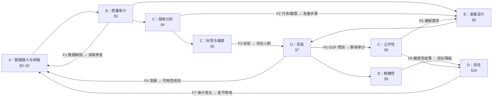
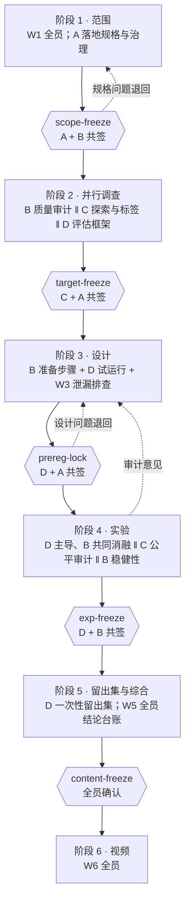

# 团队分工与协作

本文件规定四名成员（暂以 A、B、C、D 代称，确认后替换为真名）在本项目中的职责、协作方式与反馈机制。notebook 前置部分的贡献表、各节 "Section lead" 行与 GenAI 核验行由 `notebooks/final/team.json` 生成，内容与本文件一致。

组织方式不是"按章节切四块各自完成"，而是四层结构叠加：

| 层 | 作用 | 体现 |
|---|---|---|
| 各司其职 | 每节、每个模块有唯一负责人，对结果负最终责任 | 节负责人（L）、模块所有者 |
| 交叉评审 | 每节由另一名成员评审，作者不能自审 | 评审人（R）、决策记录的评审签名 |
| 共同推进 | 跨节问题由多人组成工作流一起做 | 工作流 W1–W6 |
| 反馈迭代 | 下游发现回流修改上游，冻结闸门两人共签 | 反馈回路 F1–F7、冻结标签 |

---

## 1. 角色

| 成员 | 角色 | 主导章节 | 拥有的代码与产物 | 协作中的固定职能 |
|---|---|---|---|---|
| **A** | 数据治理与可复现负责人、集成者 | §0 环境、§1 范围与治理、§2 数据来源检查 | `src/config.py`、`src/nhanes_io.py`、`src/results_io.py`、`src/plots.py`、`tools/`；`governance/` 下 DUA 清单、datasheet、GenAI 日志、决策记录合并 | 主持 W1 问题界定；冻结闸门的守门人（每个标签需 A 与提出人共签）；最终 notebook 构建与数字审计；视频统筹 |
| **B** | 数据质量与准备工程师 | §3 数据质量审计、§6 准备设计、§9 稳健性 | `src/prep.py`（14 个准备步骤 P01–P14）、`config/variable_spec.csv`（与 A 共管）、质量矩阵 | 共同负责 §7 的逐组消融；实现 C 提出的缓解措施（重加权、WHtR）；与 D 组成泄漏排查小组 |
| **C** | 探索分析、标签与偏差分析师 | §4 探索分析与谬误、§5 标签与偏差、§8 公平性 | `src/labels.py`、`src/survey.py`、`src/fairness.py` | 主导标签定义（W2）；EDA 发现直接转交 B 形成准备步骤；为 D 的实验提供评估人群（E-SCREEN）的定义 |
| **D** | 建模、评估负责人，结论汇总负责人 | §7 实验与消融、§10 综合与结论 | `src/evalkit.py`、`src/robustness.py`（留出集闸门）；`governance/hypotheses.md` 统计规则、`claims.csv`、`limitations.csv` | 起草预注册统计规则（W1）；与 B 共同负责消融；负责一次性留出集；汇总全组结论台账（W5） |

工作量平衡：A 的章节较短，但承担集成、构建、数字审计、视频统筹四项横向任务；B 与 C 各主导三节；D 主导两节，但承担全部建模代码、留出集与结论台账。

---

## 2. 分工矩阵

L = 负责人（最终负责），C = 共同负责，R = 评审人（必须签字），I = 提供输入。

| 节 | 内容 | A | B | C | D |
|---|---|---|---|---|---|
| §0 | 环境、可复现、数据校验 | **L** | I | | R |
| §1 | 问题、范围、治理、NCHS 复现 | **L** | R | C | C |
| §2 | 数据来源、规格、最小化 | **L** | R | I | |
| §3 | 数据质量审计（7 个维度） | R | **L** | I | |
| §4 | 探索分析、冗余、偏度、谬误 | | C | **L** | R |
| §5 | 标签、标签偏差、未确诊 | R | | **L** | C |
| §6 | 准备设计（14 步、6 组） | | **L** | I | R |
| §7 | 实验、逐组消融、预注册检验 | I | C | R | **L** |
| §8 | 公平性、3×3 标签矩阵、缓解 | | C | **L** | R |
| §9 | 稳健性、敏感性、外部效度 | C | **L** | R | C |
| §10 | 综合、记分表、结论台账 | C | C | C | **L** |

每名成员至少负责 2 节、评审 2–3 节、共同参与 3–4 节，没有人只在自己的章节里工作。

---

## 3. 共同推进的工作流

以下六项是跨节问题，没有哪一个人能单独完成，按工作流组织，产出物由指定成员落地。

| 工作流 | 参与 | 主持 | 产出 | 结束条件 |
|---|---|---|---|---|
| **W1 问题界定与预注册** | A B C D | A | 研究问题、可用性规则（只用筛查当时能拿到的变量）、假设 H1–H4 与判定规则 | `scope-freeze`，随后 `prereg-lock`（A + D 共签） |
| **W2 标签定义** | C D A | C | 训练标签 `L_comb`、评估人群 E-ALL / E-SCREEN、3×3 标签矩阵、敏感性标签 SL1–SL7 | `target-freeze`（C + A 共签） |
| **W3 泄漏排查** | B D C | D | 泄漏闸门（M0 → M1）、确诊年龄中位数填补伪影、"就医痕迹"变量的 T1-minus-care 对照 | 排查轮次无新泄漏（DR-S9-12） |
| **W4 偏差缓解** | C B D | C | C 发现群体差异 → B 实现缓解步骤（重加权、P14 WHtR）→ D 在同一折上评估 → C 写结论 | §8 记录"采用 / 不采用"及理由 |
| **W5 结论台账** | A B C D | D | 26 条结论（证据等级 E1–E4）、15 条局限；每人提交本节结论，D 统一措辞，A 核对数字 | 结论与 §10 记分表一致，数字审计 100% 通过 |
| **W6 视频** | A B C D | A | 讲解脚本、分段、排练 | 两次排练总长 ≤ 11 分 30 秒 |

---

## 4. 反馈回路

下游的发现必须回流修改上游，并在决策记录里留下记录。以下是本项目实际发生过的回路。

| 回路 | 从 → 到 | 触发 | 实际改动 |
|---|---|---|---|
| **F1 质量 → 接入** | B → A | B 在审计中发现 XPT 文件把 0 存成极小浮点数 | A 在 `nhanes_io` 读取时修复，B 把修复做成可开关的 P01 以测量其影响（DR-S3-01, DR-S6-03） |
| **F2 探索 → 准备** | C → B | C 发现 BMI/体重/腰围高度冗余、甘油三酯严重右偏、年龄与 BMI 非线性 | B 设计 P04 血压取均值、P05 VIF 剪枝、P13 样条（DR-S4-08, DR-S6-06, DR-S6-08） |
| **F3 标签 → 评估** | C → D | C 发现 30.5% 的自报患者 HbA1c 已被治疗压到阈值以下，且已确诊者占阳性的 84% | 训练标签改为并集 `L_comb`；D 把 E-SCREEN 设为与 E-ALL 并列的主要评估人群（DR-S5-02, DR-S5-09） |
| **F4 实验 → 范围** | D → A、B | D 的试运行中含泄漏的 M0 的 AUC 高达 0.96，决策树直接切在填补后的确诊年龄上 | A 在规格表里写入可用性规则，B 实现 P03；"医生告诉过你"类变量单独做对照组（DR-S1-04, DR-S1-05, DR-S7-07） |
| **F5 结果 → 公平 → 准备** | D → C → B → D | D 交付 OOF 预测；C 发现亚裔的 BMI 测量偏差和群体识别率差距 | B 实现 P14（WHtR 替代腰围）和重加权，D 在同一折上评估，结论"未证明有益，不采用"（DR-S5-06, DR-S8-07–09） |
| **F6 稳健性 → 结论** | B → D | B 的敏感性分析发现部分结论依赖设定；留出集只有 25 个筛查阳性 | D 降级相应结论（C09、C25 降为 E3），并写明"方向一致、不可单独检验"（DR-S10-12） |
| **F7 审计 → 全部** | 评审人 → 各负责人 | 交叉审计发现 M1 未收敛、前后数字不一致、表述过头 | 各负责人修改本节；D 补做锁定后的敏感性分析，标为 POST-LOCK（DR-S7-16, DR-S10-13） |

**规则：** 冻结前，回路可以改设计；冻结后，回路只能改措辞、降级结论或补充明确标注为"锁定后"的分析，不能为了更好看的结果重跑（预注册纪律）。

---

## 5. 推进流程

阶段之间不是单向流水线：每个阶段末有闸门，闸门上的评审意见可以把工作退回上一阶段。

| 阶段 | 并行的工作 | 汇合点 |
|---|---|---|
| 1 范围 | 全员讨论问题与假设（W1）；A 同时整理 DUA、变量规格、数据清单 | `scope-freeze`：变量范围、样本定义固定 |
| 2 调查 | B 做 7 维质量审计；C 做探索分析与标签一致性；D 搭评估框架（折、指标、配对检验） | 每周同步会上 B、C 把发现交给对方（F1、F2） |
| 3 设计 | B 把发现变成 14 个准备步骤；D 用试运行检验可行性；B + D + C 做泄漏排查（W3） | `prereg-lock`：假设、判定规则、准备步骤锁定 |
| 4 实验 | D 跑三组对比与消融（B 共同解读每组步骤的作用）；C 用 OOF 做公平审计；B 做稳健性与敏感性 | `exp-freeze`：实验配置不再改 |
| 5 综合 | D 运行一次性留出集；全员提交各节结论，D 统一，A 核对数字 | `content-freeze`：notebook 定稿 |
| 6 视频 | 每人写自己段落的讲稿，A 统筹衔接与计时 | 两次排练达标后录制 |

---

## 6. 协作机制

| 机制 | 做法 |
|---|---|
| **决策记录** | 每个重要决定写入 `governance/register/S*.csv`（发现、证据、决定、被否决的替代方案），作者与评审人都要留名；它是全组共享的"记忆"，notebook 附录 A.1 汇总展示 |
| **代码评审** | 每人在自己的分支开发；合并到 `main` 须经该节评审人（R）通过；只改自己拥有的模块，改别人的模块须先告知所有者 |
| **数字唯一来源** | 所有数字只从 `results/metrics_S*.json` 读取，不手抄；A 负责的 §10.11 数字审计逐个重算，视频里的每个数字也从这里来 |
| **轮换审计** | 每个阶段末做一次交叉审计：A 审 D 的留出集闸门，B 审 C 的标签逻辑，C 审 B 的准备步骤是否有泄漏，D 审 A 的复现与数据校验（各节固定评审人见第 2 节）；审计意见进入 F7 回路 |
| **例会** | 每周一次同步会：各人报告上周发现、需要别人接手的事项、阻塞；闸门前加开评审会 |
| **冲突处理** | 方法分歧先由该节负责人和评审人用数据讨论；仍有分歧时由主持对应工作流的成员召集全员决定，结论写入决策记录 |

---

## 7. 视频分段

讲解不用幻灯片，视频后续单独制作；画面使用 notebook 中的图。每段末尾有一句交接，点出与下一位成员工作的联系，体现协作而不是各讲各的。

| 时间 | 讲解人 | 内容 | 交接到下一段 |
|---|---|---|---|
| 0:00–0:30 | 全员同框 | 开场：每人一句自我介绍与分工 | A："先从问题和数据说起" |
| 0:30–2:40 | A | 研究问题；NHANES 与抽样设计；DUA 与数据最小化；复现 NCHS 官方数字 | "数据能用，但质量如何，交给 B" |
| 2:40–5:00 | B | 一刀切特殊编码误删 1,496 个有效值；XPT 伪影；14 步准备设计；与 D 一起发现的泄漏闸门 | "这些步骤的依据来自 C 的探索分析" |
| 5:00–7:30 | C | 冗余、共线性与偏度；辛普森悖论与因果图；治疗掩盖与未确诊风险差；公平性审计 | "标签与人群定好后，D 用模型来检验" |
| 7:30–9:45 | D | 最简与系统准备的对比（同一模型）；识别与筛查的差距；"就医痕迹"变量；一次性留出集 | "这些结论稳不稳，B 做了压力测试" |
| 9:45–10:20 | B | 稳健性：阴性对照、敏感性分析、缺失机制 | "最后全组说说收获" |
| 10:20–11:30 | 全员 | 贡献与反思：每人一句"最意外的发现"；局限与伦理；GenAI 使用说明 | — |

---

## 8. 核验分工

作业要求每名成员能解释并论证所有内容，且 GenAI 声明需写明如何核验。每人负责核验以下内容，完成后在 `team.json` 的 `verified` 和 `genai_verified` 中如实填写实际做过的事。

| 成员 | 核验任务 |
|---|---|
| A | 从全新 clone 运行 §0–§2；核对 16 个数据文件哈希；对照 NCHS Data Brief 516 核对三个复现数字；检查 notebook 中无个人数据、无本机路径 |
| B | 重跑 §3 与 §6；在原始数据中抽查特殊编码与 XPT 伪影；逐一确认 14 个准备步骤都在训练折内拟合（无泄漏） |
| C | 重跑 §4、§5、§8；手工复算 κ、30.5% 治疗掩盖比例、未确诊风险差；检查小样本群体的抑制规则 |
| D | 重跑 §7 与 §10；核对留出集只评估一次（日志与冻结记录）；抽查 5 条结论的证据等级与原始数字 |

---

## 9. 待确认事项

- 用真名替换 A–D，填写学号与组号（`notebooks/final/team.json`），然后运行 `.venv/Scripts/python tools/build_final.py --fill-team notebooks/final/CA6003_NHANES_Diabetes.ipynb`（只改文字单元格）。
- 各人完成第 8 节的核验后，把 `verified` 与 `genai_verified` 改成实际做过的事，不保留模板措辞。
- 视频分段可在排练后微调；调整后同步更新 `team.json` 的 `video_segment`。
