<!-- _class: V0 title -->
<!-- _footer: "CA6003 Data Governance · [TEAM TO FILL: group no.] · NHANES 2021–23" -->

# Who Gets Labelled Diabetic? Basic Models as Instruments on NHANES 2021–2023

Basic machine-learning models as measuring instruments on NHANES 2021–23 adult diabetes data.

<!--
We treat basic machine-learning models as measuring instruments. The question is what they reveal about the data, not how well they score.
-->

---

<!-- _class: V1_1 -->
<!-- _footer: "n = 11,933 → 5,730 · unweighted counts · §3.2" -->

# Cohort Funnel

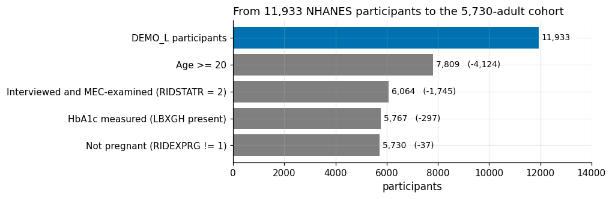

11,933 participants reduce to 5,730 analysed adults.

<!--
We keep adults who were interviewed, examined, HbA1c-measured and not pregnant. Response was 34.6% for the interview and 25.7% for the examination, so survey weights matter. Public-use files only, plus an availability rule for model features.
-->

---

<!-- _class: V1_2 -->
<!-- _footer: "n = 971 positives · unweighted · §1.4" -->

# Label Composition

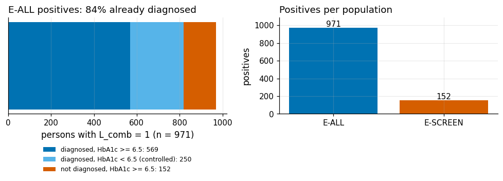

84% of 971 positives already carry a diagnosis; 152 are undiagnosed.

<!--
The label combines self-report and HbA1c, giving 971 positives and a weighted prevalence of 14.0%. Most already know. Only 152 are undiagnosed, among 4,911 adults not yet diagnosed, and they form the screening population, E-SCREEN, used later.
-->

---

<!-- _class: V1_3 -->
<!-- _footer: "n = 2,938 · weighted (WTSAF2YR) · §4.3" -->

# NCHS Replication Check

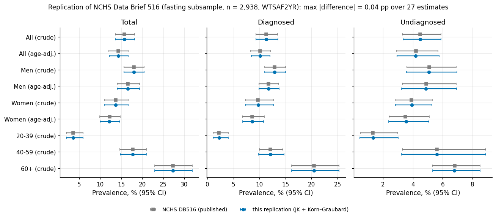

Survey code reproduces NCHS total prevalence, 15.79 versus 15.8 percent published.

<!--
Before modelling, our survey code reproduces the published NCHS figures, 15.79 versus 15.8 percent. Diagnosed 11.30 and undiagnosed 4.49 match too. Our own 14.0% differs only by label definition.
-->

---

<!-- _class: V1_4 -->
<!-- _footer: "design diagram · §6.9" -->

# Experimental Arm Design

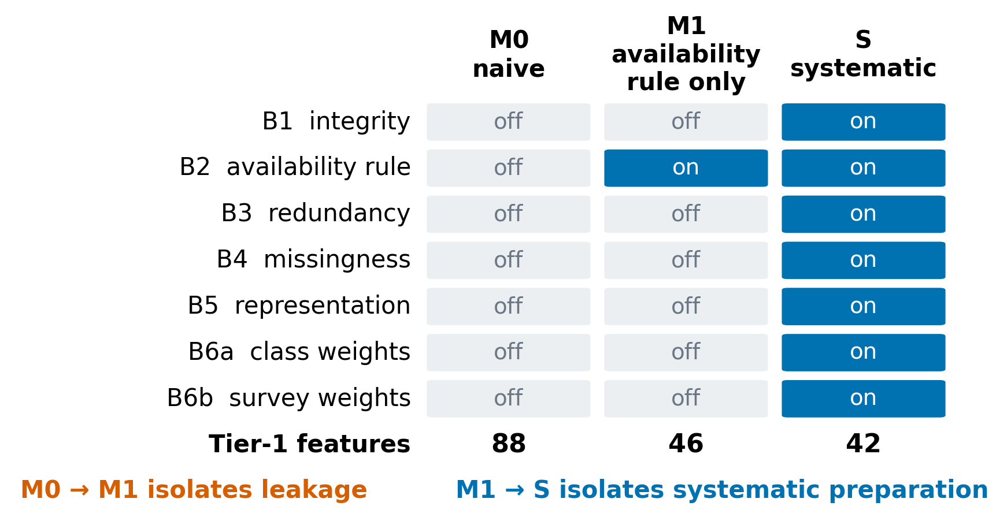

M0 is naive, M1 applies the availability rule, S adds systematic preparation.

<!--
Three arms, one model family. M0 is naive and leaky. M1 applies only the availability rule. S adds every systematic preparation step. M0 against M1 measures leakage. M1 against S measures what systematic preparation adds.
-->

---

<!-- _class: V2_1 -->
<!-- _footer: "public-use data · aggregates only · §1.8, §1.9, §3.9" -->

# Governance and Data Quality

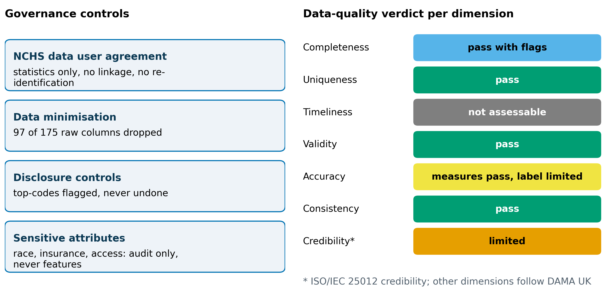

Public-use data, minimised columns, and a seven-dimension quality audit with stated limits.

<!--
Public-use data under the NCHS user agreement. We analyse aggregates only, never link records, and drop more than half the raw columns as unnecessary. The quality audit rates seven dimensions. Timeliness is not assessable and credibility is limited.
-->

---

<!-- _class: V2_2 -->
<!-- _footer: "n = 5,730 · unweighted · §3.4" -->

# Cost of Naive Cleaning

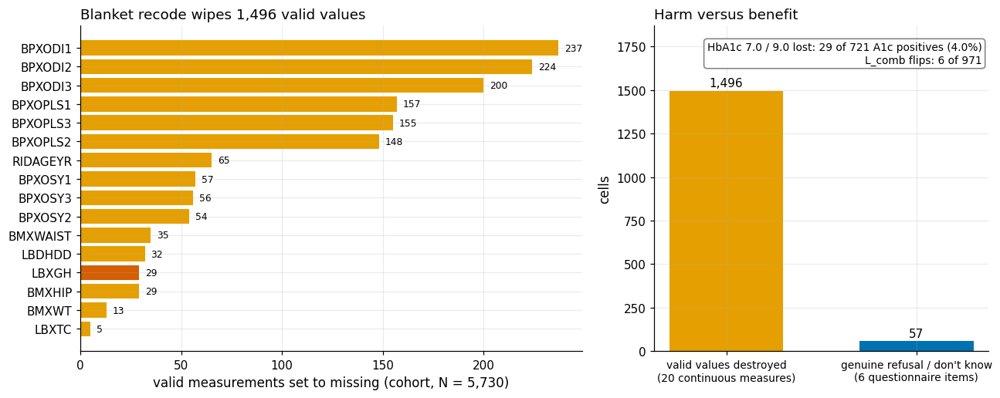

Blanket recoding destroys 1,496 valid cells, including 29 HbA1c positives.

<!--
Recoding questionnaire sentinel codes to missing looks like routine cleaning. It destroys 1,496 valid cells, including 29 of 721 HbA1c-positive labels. Our union label absorbs most of it, only 6 of 971 positives flip. Cleaning is itself a modelling decision.
-->

---

<!-- _class: V3_1 -->
<!-- _footer: "n = 4,584 (E-ALL), 127 positives (E-SCREEN) · paired CV, unweighted · §7.5" -->

# Leakage Gate

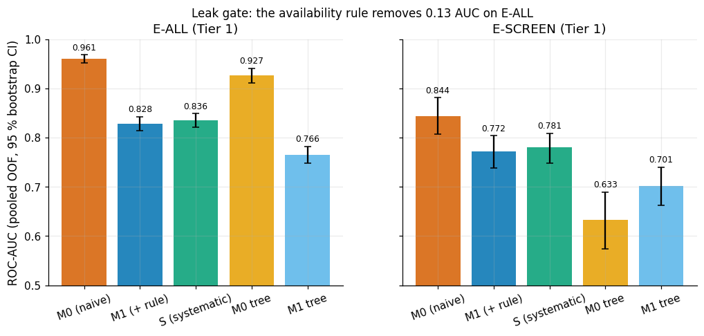

Removing leakage drops E-ALL AUC from 0.961 to 0.828.

<!--
The naive model M0 reaches AUC 0.961 on all adults. Remove inadmissible items (treatment, diagnosis history, glucose testing) and M1 falls to 0.828, a drop of 0.131, interval minus 0.148 to minus 0.114. That excess was leakage, not insight. Among the undiagnosed the drop is smaller, minus 0.072.
-->

---

<!-- _class: V3_2 -->
<!-- _footer: "n = 4,584 (E-ALL), 127 positives (E-SCREEN) · unweighted · §7.5" -->

# Median Imputation Artefact

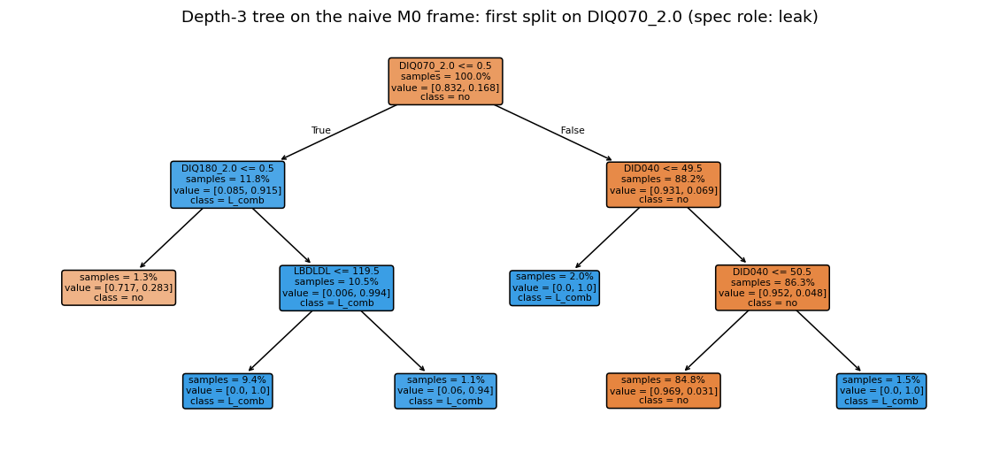

Median imputation turns 86% missing age at diagnosis into a constant 50.

<!--
Why does it leak? The naive tree splits on a treatment item, then on age at diagnosis. That item is 86% missing and median-imputed to 50, so the tree separates diagnosed people from imputed rows. On the undiagnosed, tree AUC is 0.633 for M0 against 0.701 for M1.
-->

---

<!-- _class: V4_1 -->
<!-- _footer: "complete-case adults · VIF and Spearman clusters, unweighted · §4.9" -->

# Redundancy Clusters

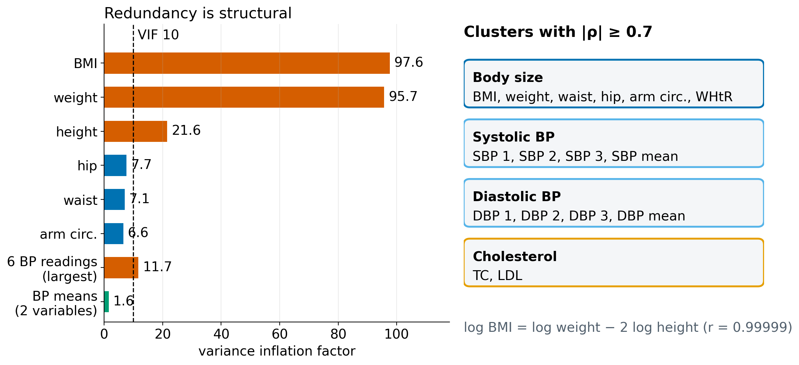

Variance inflation factors reach 95.7 for weight and 97.6 for BMI.

<!--
Redundancy is structural. Weight and BMI have variance inflation factors of 95.7 and 97.6, and waist and WHtR cluster with them. Collinear blocks need pruning or penalisation before any coefficient is interpreted.
-->

---

<!-- _class: V4_2 -->
<!-- _footer: "n = 4,584 · unweighted, bootstrap refits · §7.11" -->

# Unstable BMI Coefficient

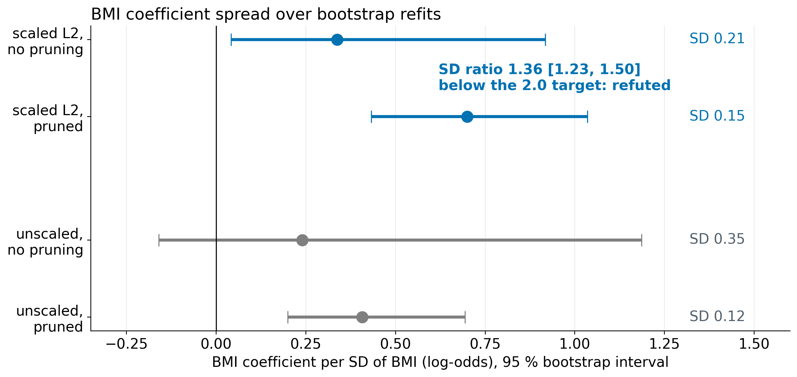

Inside scaled L2, pruning adds little (1.36, refuted).

<!--
Redundancy destabilises explanation, not prediction. Inside the scaled L2 pipeline, pruning shrinks the BMI coefficient spread only 1.36-fold, so our stability gain is refuted. Prediction barely moves.
-->

---

<!-- _class: V4_3 -->
<!-- _footer: "fasting subsample n = 2,820 · unweighted · §4.10" -->

# Skewness and Outlier Fences

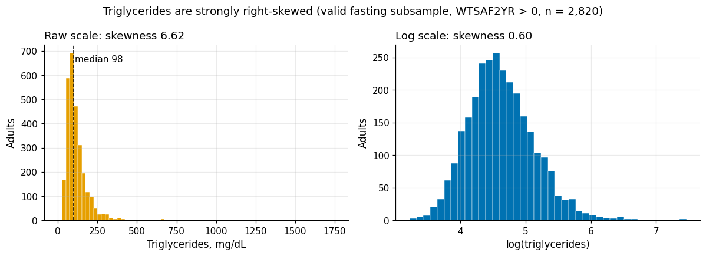

Triglyceride skewness is 6.62 against 1.22 for BMI; a log transform tames it.

<!--
Fasting triglycerides have skew 6.62, BMI 1.22. Heavy right tails need a transform, not trimming. An IQR fence on HbA1c would flag 542 values, 519 of them diabetic.
-->

---

<!-- _class: V5_1 -->
<!-- _footer: "n = 5,730 · weighted, jackknife CI · §4.5, §4.6" -->

# Age Standardisation

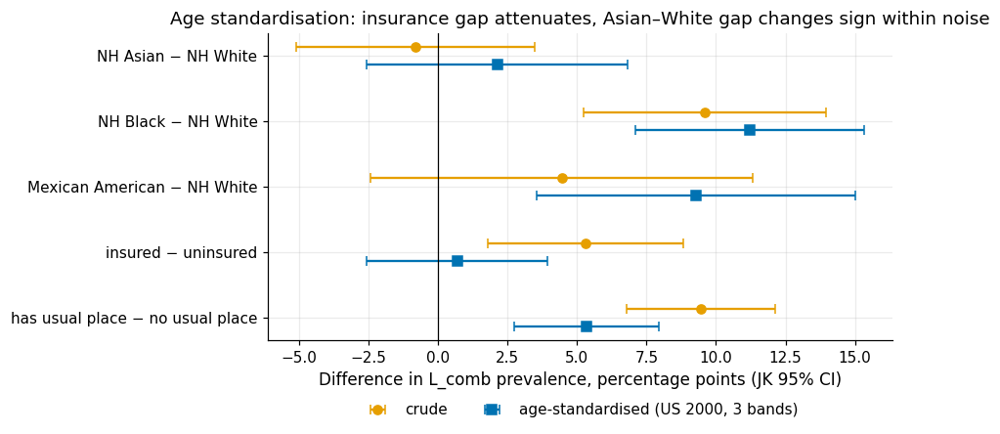

Insurance gap shrinks from +5.3 to +0.7 pp; the Asian–White sign flip stays uncertain.

<!--
The crude insurance gap is 5.3 points. After age standardisation it is 0.7. Older adults are more often insured and diabetic, so this is confounding, not a reversal. For Asian versus White, minus 0.8 flips to plus 2.1, but both intervals include zero. We report uncertainty, not a finding.
-->

---

<!-- _class: V5_2 -->
<!-- _footer: "n = 5,730 · weighted · §4.7, §4.8" -->

# BMI as Mediator

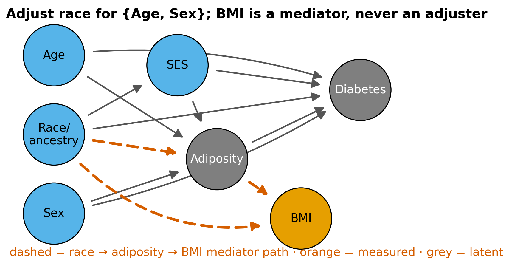

Consistent with BMI as mediator: 6 Simpson sign flips in 224 comparisons.

<!--
Our DAG places BMI between race and diabetes, a mediator, not a confounder. A scan of 224 stratified comparisons finds 6 Simpson sign flips, and most involve mediator stratifiers. Adjusting for a mediator removes part of the effect we want to describe, so we do not.
-->

---

<!-- _class: V6_1 -->
<!-- _footer: "n = 819 self-reported diabetes · unweighted · §5.2" -->

# Treatment Masking

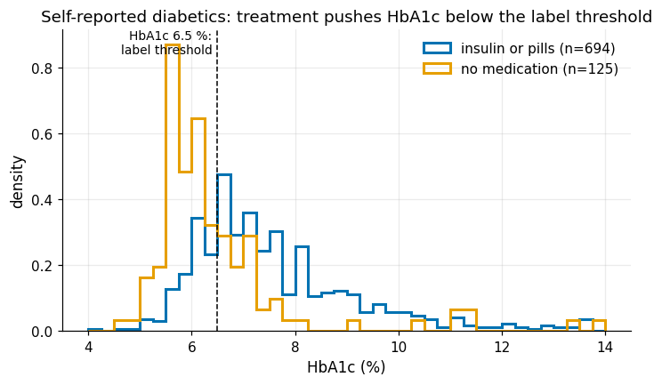

250 of 819 self-reported diabetics (30.5%) have HbA1c below 6.5; treatment masks them.

<!--
Among 819 self-reported diabetics, 250, or 30.5%, have HbA1c below 6.5, most of them on medication. An HbA1c-only label calls them negative. Treatment masks disease, so every label is a measurement with its own error.
-->

---

<!-- _class: V6_2 -->
<!-- _footer: "n = 721 adults with HbA1c ≥ 6.5 · weighted, jackknife CI · §5.4" -->

# Undiagnosed Risk Difference

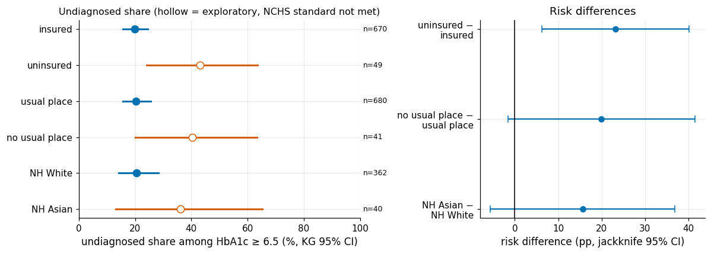

Uninsured minus insured undiagnosed share: +23.2 pp [6.2, 40.1], exploratory.

<!--
Among adults with diabetes, uninsured adults are 23.2 percentage points more often undiagnosed, interval 6.2 to 40.1. The uninsured group is small, so this is exploratory. And 68% of the undiagnosed had a blood test within three years. That is a diagnosis gap, not only access.
-->

---

<!-- _class: V6_3 -->
<!-- _footer: "n = 4,584 (training part) · unweighted · §8.6" -->

# 3×3 Label Matrix

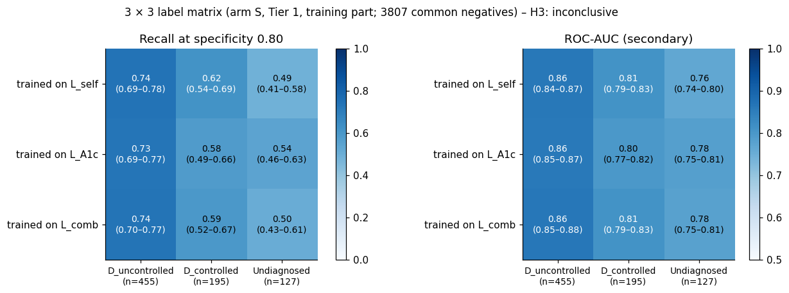

Consistent with undiagnosed cases scoring worst: recall 0.50, 0.56, 0.52 by label.

<!--
We train on three labels and score each against three groups. Undiagnosed recall is lowest under every label, 0.50 self-report, 0.56 HbA1c, 0.52 combined. Diagnosed positives are found at 0.70 against 0.52. Changing the label barely helps. These features do not find the undiagnosed.
-->

---

<!-- _class: V6_4 -->
<!-- _footer: "NH Asian subsample (exploratory) · prevalence weighted, AUC unweighted · §5.5" -->

# Asian BMI versus WHtR

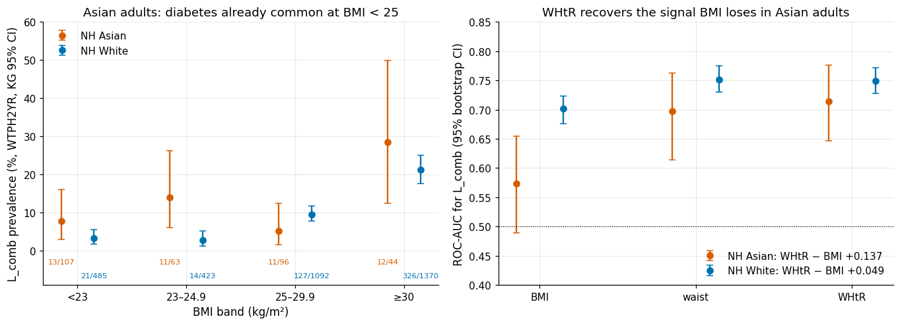

Consistent with BMI under-measuring Asian adiposity: AUC 0.573 against 0.714 for WHtR.

<!--
BMI cut-offs under-measure adiposity in Asian adults. 51.1% of Asian diabetics have BMI below 25, against 7.2% of White diabetics. Waist-to-height ratio ranks Asian cases better, AUC 0.714 against 0.573. Small subgroup, exploratory.
-->

---

<!-- _class: V6_5 -->
<!-- _footer: "n = 4,584 (training part) · unweighted · §8.3, §8.12" -->

# Group TPR Gap

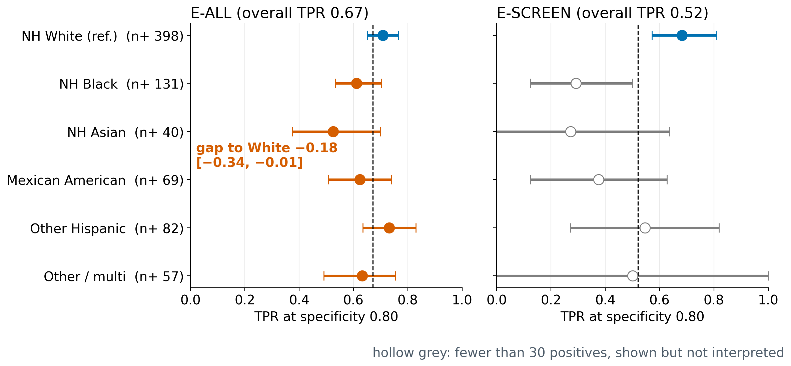

Suggests a TPR gap for NH Asian adults, -0.184; exploratory.

<!--
At the same specificity, the model flags Asian adults with diabetes less often than White adults, a TPR gap of minus 0.184, with few positives. Observed over expected is 1.30 for Black, 0.88 for White and 1.35 for Asian adults.
-->

---

<!-- _class: V7_1 -->
<!-- _footer: "n = 5,730 · unweighted · §4.11" -->

# Algorithm Justification

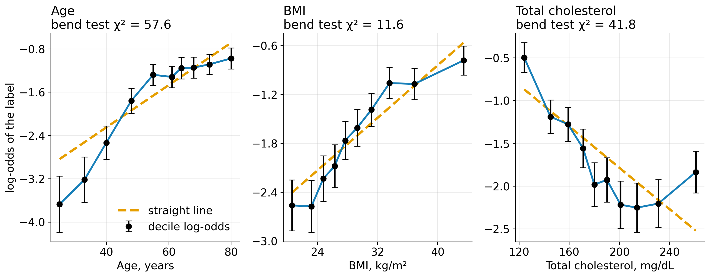

Smooth non-linear signal justifies spline logistic regression and shallow trees.

<!--
The EDA justifies the algorithms. Log-odds bend, so spline logistic regression, with shallow trees as a probe. Basic models only.
-->

---

<!-- _class: V7_2 -->
<!-- _footer: "n = 4,584 (E-ALL), 127 positives (E-SCREEN) · paired CV, unweighted · §7.7, §10.2.1" -->

# Minimal versus Systematic Preparation

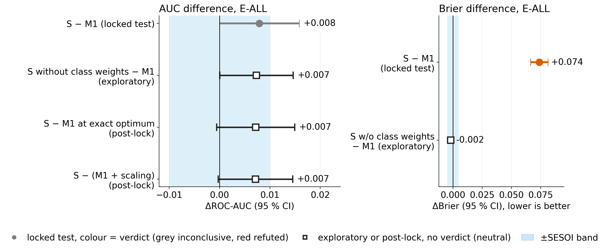

S minus M1 ΔAUC +0.008 [+0.000, +0.016]; without class weights +0.007, Brier -0.002; inconclusive.

<!--
Minimal M1 against systematic S, same model. The AUC gain is plus 0.008, interval 0.000 to 0.016, minimum detectable difference 0.011, so inconclusive. Class weights alone worsen Brier by 0.076. Without them S gains 0.007 AUC and improves Brier by 0.002. M1 hit its iteration limit in 25 folds, but converged or scaled variants keep the verdict.
-->

---

<!-- _class: V7_3 -->
<!-- _footer: "n = 4,584 / 127 positives · paired CV, unweighted · §7.9, §9.11, §10.6" -->

# Recognition versus Screening

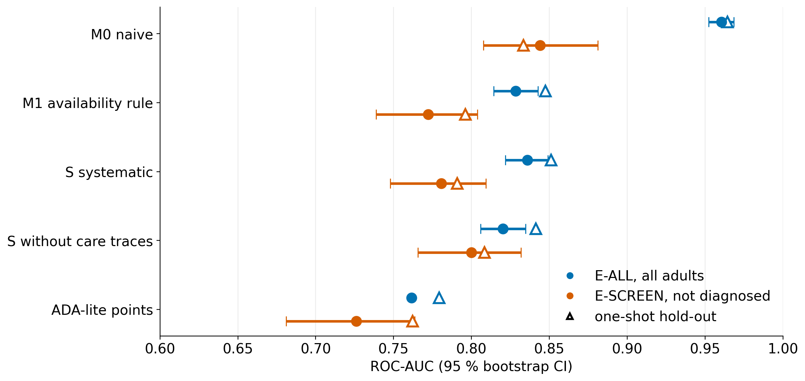

Whole-sample AUC overstates screening, 0.836 on E-ALL against 0.781 on E-SCREEN (gap +0.055).

<!--
Same predictions, two populations. Arm S scores 0.836 on all adults but 0.781 on the undiagnosed, a gap of 0.055. Whole-sample AUC measures recognition. Removing care-trace items lowers E-ALL by 0.016 yet raises E-SCREEN by 0.019. Against ADA-lite, S leads by 0.055 in cross-validation but only 0.029 on the hold-out, interval minus 0.037 to 0.098, inconclusive.
-->

---

<!-- _class: V7_4 -->
<!-- _footer: "hold-out n = 1,146 · robustness on training part, n = 4,584 · unweighted · §9.10, §9.11" -->

# Hold-Out and Robustness

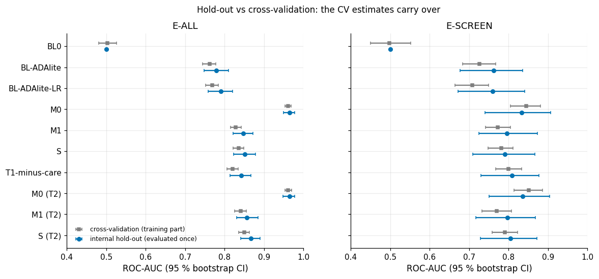

Hold-out matches cross-validation, arm S 0.851 and 0.791; robustness checks leave S minus M1 unchanged.

<!--
One shot, evaluated once. Arm S scores 0.851 and 0.791, close to cross-validation, but the screening hold-out has few positives. Seeds, specifications, grouped cross-validation and weights leave S minus M1 small and inconclusive. Permuted labels give AUC 0.501.
-->

---

<!-- _class: V8_1 text -->
<!-- _footer: "26 graded claims · weighted where stated · §10.7" -->

# Conclusions

- Leakage inflates AUC
- Age confounds gaps
- Labels mask cases
- AUC measures recognition

<!--
Three findings and one headline. Leakage and naive cleaning inflate performance. Age and mediators create fallacies, and labels mask cases. The headline is that whole-sample AUC measures recognition, 0.836 versus 0.781 on the undiagnosed. Of the hypotheses, 10 are supported, 6 inconclusive, 1 mixed, across 26 graded claims.
-->

---

<!-- _class: V8_2 text -->
<!-- _footer: "152 screening positives · aggregates only · §10.9, §10.10" -->

# Limitations and Ethics

- Observational US data
- 152 screening positives
- Subgroups exploratory
- Not a clinical tool

<!--
Limits are observational US data, not Singapore, and only 152 screening positives, so subgroups are exploratory. Ethics. Public-use data, aggregates only, race used for audit and never as a feature. Not a clinical tool, and fairness is not certified.
-->

---

<!-- _class: V8_3 template -->
<!-- _footer: "front-matter contribution table · GenAI log in governance/genai_log.csv" -->

# Contributions and GenAI

| Member | Role | Notebook sections | Video segment |
|---|---|---|---|
| [TEAM TO FILL: name] | [TEAM TO FILL: role] | [TEAM TO FILL: § list] | [TEAM TO FILL: mm:ss–mm:ss] |
| [TEAM TO FILL: name] | [TEAM TO FILL: role] | [TEAM TO FILL: § list] | [TEAM TO FILL: mm:ss–mm:ss] |
| [TEAM TO FILL: name] | [TEAM TO FILL: role] | [TEAM TO FILL: § list] | [TEAM TO FILL: mm:ss–mm:ss] |
| [TEAM TO FILL: name] | [TEAM TO FILL: role] | [TEAM TO FILL: § list] | [TEAM TO FILL: mm:ss–mm:ss] |

GenAI. Claude (Anthropic) supported planning, code drafting and audits; no LLM in the pipeline. [TEAM TO FILL: confirm wording against the declaration in the front matter]

<!--
Each member names their role and notebook sections on screen. For GenAI, Claude assisted planning, code drafting and audits under our direction. No LLM sits in the pipeline, and every number was recomputed and checked by us.
-->
